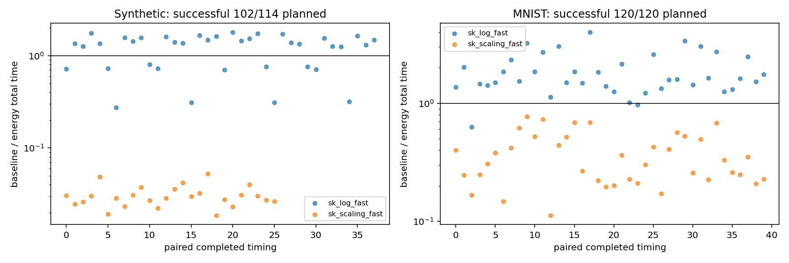
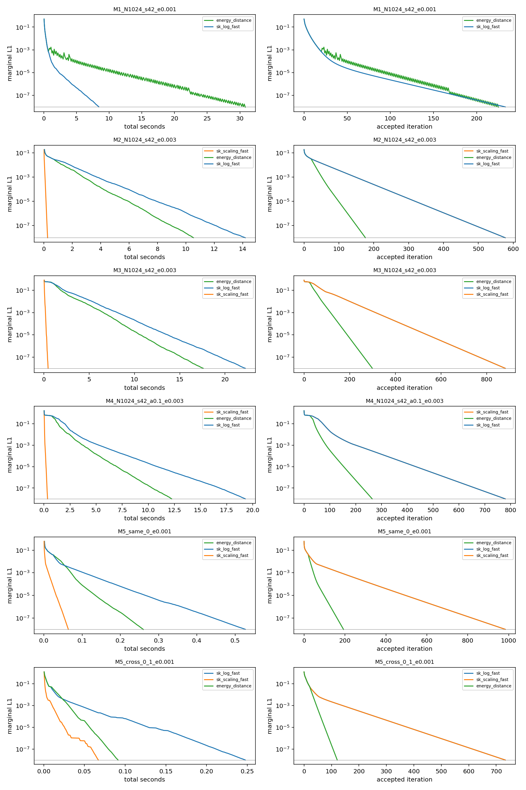
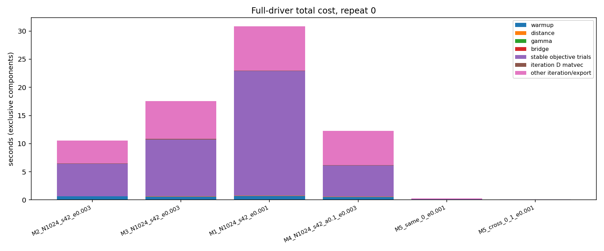
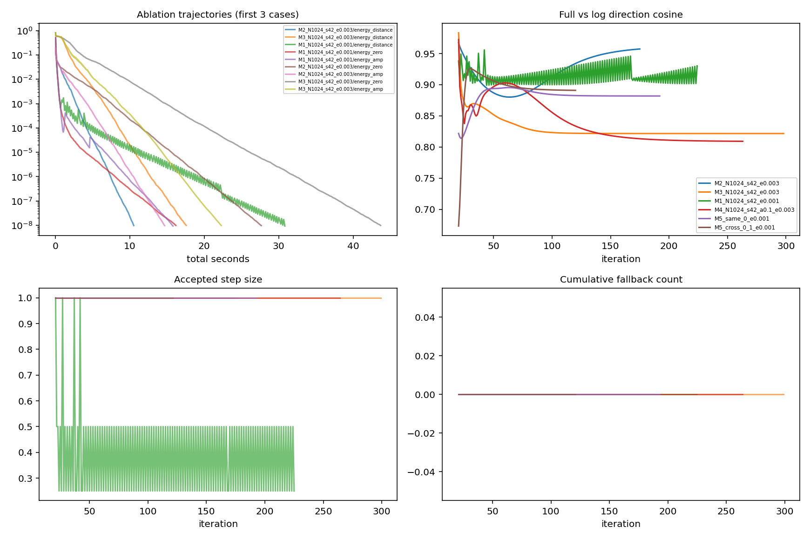
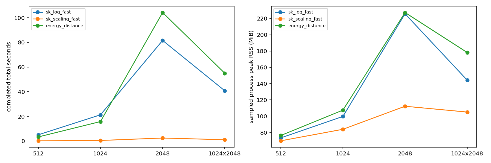

# 完整成本距离驱动 Sinkhorn：v0 实测报告

**结论：完整成本距离驱动相对 log SK 在多数几何输入上获得了总墙钟收益，但没有胜过任何可用的原始缩放 SK。** 78 对 log SK 配对中 64 对更快（中位时间比 1.48）；66 对可用缩放 SK 配对中 0 对更快（中位比 0.209）。这些是两次重复计时的描述统计，不是独立样本推断。

按家族看，M2、M3、M4 相对 log SK 的中位时间比分别为 1.63、1.39、1.51；MNIST 为 1.58（38/40 对更快）。M1 全部变慢，中位比 0.510；2048 规模与 1024×2048 非方阵也变慢。不能把 512、1024 的收益外推至更大规模。

主要开销是稳定目标差及试探，而非构造 D 或 D@e。例如 M1(seed=42, epsilon=0.001, repeat=0) 只有小幅接受步减少，30.83 秒总时间却有 22.16 秒用于稳定目标差；509 次试探中拒绝 304 次，D 构造加全部 D@e 不到 0.12 秒。2048 首轮的 101.95 秒中，稳定目标差占 71.25 秒，超过对应 log SK 的总成本所能抵消的范围。

六个代表例的方向余弦中位数为 0.821–0.924，方向确实发生了变化；几何代表例中完整方法均快于幅度匹配，随机成本代表例则反而更慢。有限消融支持“方向变化在部分几何问题上有用”，不支持普遍有效或统计显著的结论。正式完整方法没有触发 SK 回退，但随机成本有大量拒绝试探。

本轮实际计划 262 条，状态统计：{"success": 250, "not_applicable_kernel_underflow": 12}。正式输入覆盖 39/39；三方法两次均成功的输入 33/39。最终机器累计时间 2408.54 秒（含排除尝试与最终复核）；未完成项保留在 pending.csv。

相对 sk_log_fast：78 对验收成功的配对计时，总时间比中位数 1.48，范围 0.273–3.98；大于 1 表示新方法更快。
相对 sk_scaling_fast：66 对验收成功的配对计时，总时间比中位数 0.209，范围 0.0185–0.772；大于 1 表示新方法更快。

开销观察：distance_build_sec 中位数 0.00251；energy_matvec_sec 中位数 0.00173；objective_diff_sec 中位数 0.141；trial_state_sec 中位数 0.0922；rejected_trials 中位数 0；fallback_count 中位数 0。接受步减少并不自动意味着总墙钟收益；下方按家族配对表包含本轮重新计时的两种 SK。目标差属于 iteration_sec；energy_matvec_sec 包含 gamma 初始化的一次乘法，图中已将初始化计入 gamma、其余计入 iteration D matvec，互斥分项不重复累加。

方向是否改变及是否有用：见方向诊断和六例消融。cos 越接近 1，方向越接近原对数残差；幅度匹配与完整方向各走独立轨道。有限消融只有一次计时，不能据此宣称统计显著性。若消融未完成，机制问题仍未回答。

## 固定协议与参数

统一 kappa=3.0，选择原因 `success_count_then_common_geomean_then_smaller`。gamma：最小 0.08718，中位 0.42，最大 40.46；零值 0 条。

使用 OT Python 3.9、串行、BLAS 线程 1；环境详见 environment.json。tol=1e-8，max_iter=50000，最多 20 步共享预热。log SK 和新方法各自总时间都含预热；原始缩放 SK 冷启动并计入核构造。M5 按真实非零灰度支持计算，尺寸见 inputs/*/metadata.json 与 runs.csv。没有运行 5000 或 10000 求解。

测量实现指纹：`3983cd0a5337589c26f93d4e624ef873d24d21d886f3b40b6316a9c7b9fb5d3e`。当前报告/入口修订指纹：`8fe562f42eee92c0688023a9ad14d40318246bf9aa39fcfd886527377ab27eb4`。配置指纹：`7ffaaff2ae918dcf9911acf65a63ce89fe2d81d40c10c213291312d74ace1aeb`。起点提交由 environment.json 记录；任务开始时为 61af801ed0b89a0c2b6c23ac1a29382f02a3e886，用户已有 notes 改动保留。代码快照在 source/。报告修订来源：`D:\sinkhorn-lmflow\results\20261111_121604_269934_energy_distance_v0_rev0`；报告层修订不产生新求解轨道，不重置累计预算。

## 覆盖与失败

| stage | family | method | status | count |
| --- | --- | --- | --- | --- |
| ablation | M1 | energy_amp | success | 1 |
| ablation | M1 | energy_zero | success | 1 |
| ablation | M2 | energy_amp | success | 1 |
| ablation | M2 | energy_zero | success | 1 |
| ablation | M3 | energy_amp | success | 1 |
| ablation | M3 | energy_zero | success | 1 |
| ablation | M4 | energy_amp | success | 1 |
| ablation | M4 | energy_zero | success | 1 |
| ablation | M5 | energy_amp | success | 2 |
| ablation | M5 | energy_zero | success | 2 |
| calibration | M1 | energy_distance | success | 3 |
| calibration | M1 | sk_log_fast | success | 1 |
| calibration | M2 | energy_distance | success | 3 |
| calibration | M2 | sk_log_fast | success | 1 |
| calibration | M3 | energy_distance | success | 3 |
| calibration | M3 | sk_log_fast | success | 1 |
| calibration | M4 | energy_distance | success | 3 |
| calibration | M4 | sk_log_fast | success | 1 |
| main | M1 | energy_distance | success | 8 |
| main | M1 | sk_log_fast | success | 8 |
| main | M1 | sk_scaling_fast | not_applicable_kernel_underflow | 4 |
| main | M1 | sk_scaling_fast | success | 4 |
| main | M2 | energy_distance | success | 8 |
| main | M2 | sk_log_fast | success | 8 |
| main | M2 | sk_scaling_fast | not_applicable_kernel_underflow | 4 |
| main | M2 | sk_scaling_fast | success | 4 |
| main | M3 | energy_distance | success | 8 |
| main | M3 | sk_log_fast | success | 8 |
| main | M3 | sk_scaling_fast | not_applicable_kernel_underflow | 4 |
| main | M3 | sk_scaling_fast | success | 4 |
| main | M4 | energy_distance | success | 8 |
| main | M4 | sk_log_fast | success | 8 |
| main | M4 | sk_scaling_fast | success | 8 |
| main | M5 | energy_distance | success | 40 |
| main | M5 | sk_log_fast | success | 40 |
| main | M5 | sk_scaling_fast | success | 40 |
| main | M6 | energy_distance | success | 4 |
| main | M6 | sk_log_fast | success | 4 |
| main | M6 | sk_scaling_fast | success | 4 |
| main | M7 | energy_distance | success | 2 |
| main | M7 | sk_log_fast | success | 2 |
| main | M7 | sk_scaling_fast | success | 2 |

not_applicable_kernel_underflow 是原始缩放表示不适用，不当作收敛失败。timeout、资源跳过、预算未启动均保留在计划分母，不用截止时间伪装成功。终点依据保存的 mu、nu 独立分块重算；审计详见 endpoint_audit.json。

## 各家族、epsilon 的配对总时间比

| family | epsilon | baseline | pairs | median_speedup | min_speedup | max_speedup |
| --- | --- | --- | --- | --- | --- | --- |
| M1 | 0.001 | sk_log_fast | 4 | 0.3115 | 0.2734 | 0.3173 |
| M1 | 0.003 | sk_log_fast | 4 | 0.7128 | 0.7033 | 0.7239 |
| M1 | 0.003 | sk_scaling_fast | 4 | 0.03101 | 0.03045 | 0.03605 |
| M2 | 0.001 | sk_log_fast | 4 | 1.65 | 1.562 | 1.715 |
| M2 | 0.003 | sk_log_fast | 4 | 1.579 | 1.347 | 1.787 |
| M2 | 0.003 | sk_scaling_fast | 4 | 0.03882 | 0.02461 | 0.04192 |
| M3 | 0.001 | sk_log_fast | 4 | 1.41 | 1.302 | 1.477 |
| M3 | 0.003 | sk_log_fast | 4 | 1.335 | 1.259 | 1.45 |
| M3 | 0.003 | sk_scaling_fast | 4 | 0.02845 | 0.02599 | 0.03043 |
| M4 | 0.003 | sk_log_fast | 8 | 1.506 | 1.258 | 1.763 |
| M4 | 0.003 | sk_scaling_fast | 8 | 0.02806 | 0.0223 | 0.0324 |
| M5 | 0.001 | sk_log_fast | 20 | 2.243 | 0.9688 | 3.981 |
| M5 | 0.001 | sk_scaling_fast | 20 | 0.4142 | 0.1954 | 0.7721 |
| M5 | 0.01 | sk_log_fast | 20 | 1.455 | 0.632 | 1.849 |
| M5 | 0.01 | sk_scaling_fast | 20 | 0.253 | 0.112 | 0.6212 |
| M6 | 0.003 | sk_log_fast | 4 | 1.082 | 0.759 | 1.734 |
| M6 | 0.003 | sk_scaling_fast | 4 | 0.03606 | 0.02306 | 0.05291 |
| M7 | 0.003 | sk_log_fast | 2 | 0.7416 | 0.7244 | 0.7588 |
| M7 | 0.003 | sk_scaling_fast | 2 | 0.01888 | 0.01855 | 0.01921 |

同一输入的两次计时不是独立数据样本；不报告由此生成的置信区间。预热内收敛的收益不归因于新驱动，配对表有 warmup_converged 标志。

## 最差反例

| case_id | repeat | baseline | speedup | baseline_sec | new_sec |
| --- | --- | --- | --- | --- | --- |
| M7_1024x2048_s42_e0.003 | 1 | sk_scaling_fast | 0.01855 | 1.008 | 54.35 |
| M7_1024x2048_s42_e0.003 | 0 | sk_scaling_fast | 0.01921 | 1.069 | 55.65 |
| M4_N1024_s43_a1_e0.003 | 0 | sk_scaling_fast | 0.0223 | 0.4466 | 20.02 |
| M6_N2048_s42_e0.003 | 1 | sk_scaling_fast | 0.02306 | 2.456 | 106.5 |
| M6_N2048_s42_e0.003 | 0 | sk_scaling_fast | 0.02342 | 2.388 | 101.9 |
| M2_N1024_s42_e0.003 | 0 | sk_scaling_fast | 0.02461 | 0.2593 | 10.54 |
| M3_N1024_s42_e0.003 | 0 | sk_scaling_fast | 0.02599 | 0.457 | 17.58 |
| M4_N1024_s43_a0.1_e0.003 | 1 | sk_scaling_fast | 0.02648 | 0.3095 | 11.69 |
| M3_N1024_s43_e0.003 | 0 | sk_scaling_fast | 0.02688 | 0.4895 | 18.21 |
| M4_N1024_s43_a1_e0.003 | 1 | sk_scaling_fast | 0.02721 | 0.5198 | 19.1 |
| M4_N1024_s42_a0.1_e0.003 | 1 | sk_scaling_fast | 0.02761 | 0.358 | 12.97 |
| M4_N1024_s42_a0.1_e0.003 | 0 | sk_scaling_fast | 0.02852 | 0.3489 | 12.24 |

## 有限消融与方向诊断

| case_id | method | status | total_sec | n_iter | gamma | fallback_count |
| --- | --- | --- | --- | --- | --- | --- |
| M1_N1024_s42_e0.001 | energy_zero | success | 16.19 | 233 | 0 | 0 |
| M1_N1024_s42_e0.001 | energy_amp | success | 15.8 | 153 | 13.91 | 0 |
| M2_N1024_s42_e0.003 | energy_zero | success | 27.66 | 577 | 0 | 0 |
| M2_N1024_s42_e0.003 | energy_amp | success | 14.68 | 303 | 0.4102 | 0 |
| M3_N1024_s42_e0.003 | energy_zero | success | 43.69 | 881 | 0 | 0 |
| M3_N1024_s42_e0.003 | energy_amp | success | 22.29 | 463 | 0.2918 | 0 |
| M4_N1024_s42_a0.1_e0.003 | energy_zero | success | 34.45 | 779 | 0 | 0 |
| M4_N1024_s42_a0.1_e0.003 | energy_amp | success | 16.97 | 413 | 0.3161 | 0 |
| M5_same_0_e0.001 | energy_zero | success | 1.255 | 983 | 0 | 0 |
| M5_same_0_e0.001 | energy_amp | success | 0.7631 | 520 | 0.7267 | 0 |
| M5_cross_0_1_e0.001 | energy_zero | success | 0.8392 | 733 | 0 | 0 |
| M5_cross_0_1_e0.001 | energy_amp | success | 0.5138 | 405 | 1.232 | 0 |

| case_id | method | median_cos | min_cos | median_q | fallbacks |
| --- | --- | --- | --- | --- | --- |
| M2_N1024_s42_e0.003 | energy_distance | 0.9235 | 0.8802 | 1.296 | 0 |
| M3_N1024_s42_e0.003 | energy_distance | 0.8217 | 0.8217 | 1.637 | 0 |
| M1_N1024_s42_e0.001 | energy_distance | 0.9117 | 0.899 | 4.339 | 0 |
| M4_N1024_s42_a0.1_e0.003 | energy_distance | 0.8213 | 0.8093 | 1.447 | 0 |
| M5_same_0_e0.001 | energy_distance | 0.8824 | 0.8139 | 2.688 | 0 |
| M5_cross_0_1_e0.001 | energy_distance | 0.8943 | 0.6733 | 1.154 | 0 |
| M1_N1024_s42_e0.001 | energy_zero | 1 | 1 | 0 | 0 |
| M1_N1024_s42_e0.001 | energy_amp | 1 | 1 | 3.148 | 0 |
| M2_N1024_s42_e0.003 | energy_zero | 1 | 1 | 0 | 0 |
| M2_N1024_s42_e0.003 | energy_amp | 1 | 1 | 1.784 | 0 |
| M3_N1024_s42_e0.003 | energy_zero | 1 | 1 | 0 | 0 |
| M3_N1024_s42_e0.003 | energy_amp | 1 | 1 | 1.757 | 0 |
| M4_N1024_s42_a0.1_e0.003 | energy_zero | 1 | 1 | 0 | 0 |
| M4_N1024_s42_a0.1_e0.003 | energy_amp | 1 | 1 | 1.026 | 0 |
| M5_same_0_e0.001 | energy_zero | 1 | 1 | 0 | 0 |
| M5_same_0_e0.001 | energy_amp | 1 | 1 | 1.875 | 0 |
| M5_cross_0_1_e0.001 | energy_zero | 1 | 1 | 0 | 0 |
| M5_cross_0_1_e0.001 | energy_amp | 1 | 1 | 2.64 | 0 |

## 理论边界

Energy distance 是已有构造。本方法是由成本几何构造的预条件梯度方法，保持 EOT 镜像几何与原平衡点，并提供连续下降方向；离散加速没有先验证明。固定成本距离不移除实际质量响应 L_P，也不保证跨越所有弱连接。使用距离而非平方距离，不构造 Hessian、谱分解或近似几何。结果仅覆盖至 2048，不能外推更大规模。

## 产物与恢复

结果目录：`D:\sinkhorn-lmflow\results\20261111_125856_524318_energy_distance_v0_rev2`。

CSV：calibration.csv、runs.csv、threshold_costs.csv、coverage.csv、failures.csv、pending.csv、paired_speedups.csv、direction_summary.csv。

恢复执行：`scripts\run_ot.cmd scripts/run_energy_distance_study.py --config configs/energy_distance_v0.yaml`。同一账本累计预算，匹配终态不重跑；实现变更必须使用 --new-revision，仍保留累计账本。预算已耗尽时恢复不会增加求解额度。

只重建报告：`scripts\run_ot.cmd scripts/report_energy_distance.py --run-dir "D:\sinkhorn-lmflow\results\20261111_125856_524318_energy_distance_v0_rev2" --audit --report docs/energy_distance_v0_report.md`。

单独执行报告命令的机器开销记录到 report_rebuilds.json，不作为新增正式求解时间。首次自动报告包含在实验账本；没有复用旧 SR1 结果或账本。

## 图表

本次自动报告耗时 10.52 秒；报告完成时机器累计 2397.35 秒。

## 六例完整方法与消融的直接比较

| case_id | log_sec | full_sec | zero_sec | amp_sec | amp_over_full | log_updates | full_updates | stable_difference_sec | rejected_trials |
| --- | --- | --- | --- | --- | --- | --- | --- | --- | --- |
| M1_N1024_s42_e0.001 | 8.427 | 30.83 | 16.19 | 15.8 | 0.5127 | 233 | 225 | 22.16 | 304 |
| M2_N1024_s42_e0.003 | 14.19 | 10.54 | 27.66 | 14.68 | 1.394 | 577 | 176 | 5.749 | 0 |
| M3_N1024_s42_e0.003 | 22.23 | 17.58 | 43.69 | 22.29 | 1.268 | 881 | 299 | 10.07 | 0 |
| M4_N1024_s42_a0.1_e0.003 | 19.29 | 12.24 | 34.45 | 16.97 | 1.387 | 779 | 264 | 5.535 | 0 |
| M5_same_0_e0.001 | 0.5268 | 0.2603 | 1.255 | 0.7631 | 2.932 | 983 | 193 | 0.1364 | 0 |
| M5_cross_0_1_e0.001 | 0.2476 | 0.09127 | 0.8392 | 0.5138 | 5.629 | 733 | 121 | 0.0465 | 0 |

## 实现、验证和运行修订记录

新增模块为 core/cost_profile_distance.py、solvers/energy_distance.py、experiments/energy_distance_study.py 和 plotting/energy_distance.py；新增主入口、报告入口、固定 YAML 配置和三组测试。没有修改已有两种 SK 的实现。距离一般路径和精确几何路径、一般等质量问题、稳定分块目标差、固定 gamma、回退、计划数量和恢复均有测试。

核心及相关回归共 31 项通过；报告层修复后 18 项核心门禁通过，并加入配对表非空以及“仅报告修订禁止启动任何求解器”的回归断言。final_verification.json 记录再次独立审计的 250 个有效端点、12 个不适用端点、144 对时间比、786 条阈值记录，以及原始和最终修订逐轨道文件哈希完全一致。MNIST 实际支持范围为 n=132–267、m=115–206，原始索引、质量和掩码保存在输入描述与 reconstruction.npz 中。

必须披露一次执行偏差：最初报告的 pandas 行索引错误造成配对图表为空；修订时 Windows 路径分隔符检查又误启动了 rev1 的重复实验。发现后停止，rev1 中 9 条已完成和 1 条中断尝试全部排除，不用于选参或结论；其机器时间仍计入同一账本，没有重置预算。rev0 的完整 262 条计划保持不变，最终 rev2 只继承 rev0 的原始测量并修正报告。详情见 excluded_revision.json；rev1 保留 EXCLUDED_FROM_FORMAL_STUDY.json，不能将它的条目合并进本轮正式比较。修复后的显式 --report-from 入口只接受全部完成且计算源码、配置未改变的计划，并禁止启动求解。

最初完整测量和自动报告耗时 2271.04 秒（37 分 51 秒）；最终累计还包括上述排除尝试、报告修订和独立复核，见下方及独立预算账本。没有推送、合并远端或触碰旧 SR1 账本。正式计划没有未完成条目；上述额外尝试是执行偏差，不能称为严格只启动了 262 条轨道。

报告主体由持久化产物自动生成，本节解读由 tmp/energy_finalize_report.py 从同一产物补充。完整复核脚本为 tmp/energy_final_verify.py。重复生成基础报告后可运行补充脚本恢复这份解读。

最终累计机器时间：2408.54 秒，预算 3600 秒，超额 0 秒。
