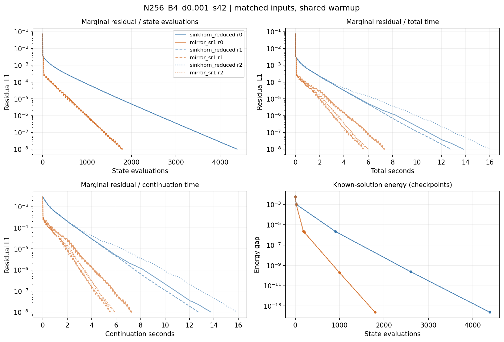
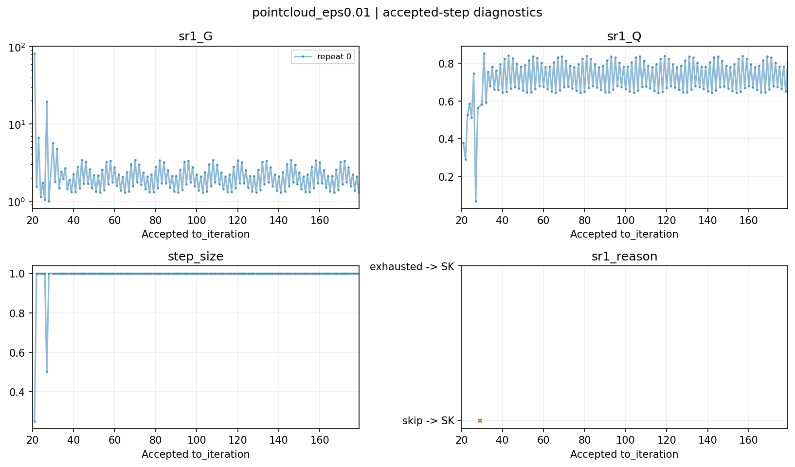

# Mirror 驱动正 SR1 v0：本地实现与实验报告

日期：2026-11-10。实验基于本地 `main` 的 `886445543600bef327b6a54ea1ed30ccef57d403` 及本轮源码改动；运行元数据如实记录实验当时的提交与 dirty 状态。后续按用户追加指令发布到 GitHub，发布提交见仓库历史。

## 1. 结论与覆盖

三阶段正式实验 **114/114 条轨道达到原定边际残差 1e-8**，未放宽停止阈值，未裁剪边际，未增加多对记忆。单对正 SR1 在这些问题上通常能形成有效方向，耗散增益转化成了接受步的目标下降。

收益明显依赖结构。两组受控核在共享 20 步预热后只需要再做 1–4 步 SR1；四组弱耦合核仍需要数百到上千步。最终精度下，54 个受控配对的总时间比 `T_SK/T_SR1` 范围为 **1.499–268.662**，中位数 **3.126**；两个点云的单次时间比分别为 **2.884、2.628**。跨问题中位数只是本次矩阵的描述，不是一般 EOT 加速率。

无收益结果也保留：`B=4, δ=0.1, 初值 seed=44, repeat=1` 在 `1e-4` 阈值时，两方法都是 21 步、23 次评估；SK 为 0.076385 秒，SR1 为 0.076859 秒，时间比 **0.993830**。这一次约 0.6% 的计时劣势不能解释为稳定退化，也不能从结果表删除。

| 阶段 | case × 重复 × 方法 | 成功 | study 命令耗时，不含随后绘图 |
|---|---:|---:|---:|
| Smoke，N=32/B=2/δ=0.01/seed=42 | 1 × 1 × 2 | 2/2 | 0.883 秒 |
| Controlled，N=256，B=2/4，δ=0.1/0.01/0.001，初值 seed=42/43/44 | 18 × 3 × 2 | 108/108 | 373.293 秒 |
| Transfer，N=128 点云，数据 seed=42，ε=0.05/0.01 | 2 × 1 × 2 | 4/4 | 1.566 秒 |

正式运行没有失败、超时或 pending。强制故障测试覆盖了这些路径，没有把测试故障混入实测成功率。

## 2. 工作区与实现

任务前原有 71 项测试通过（3.69 秒）。初始源码目录无待提交修改；已有 5 个受跟踪笔记文件被修改，另有未跟踪笔记和 tmp 内容，均保留。任务原文已复制到 [sr1_v0_task.md](sr1_v0_task.md)。

| 新增路径 | 职责 |
|---|---|
| `src/sinkhorn_lmflow/core/semi_dual.py` | 行归一化评估、中心化列坐标、稳定目标差与 Bregman 核 |
| `src/sinkhorn_lmflow/solvers/mirror_sr1.py` | 当前 B0、最近一对正 SR1、六次试探、单位 SK 回退、共享预热快照 |
| `src/sinkhorn_lmflow/problems/weak_coupling.py` | 不归一化成本的受控核、独立初值及 SHA256 |
| `src/sinkhorn_lmflow/experiments/sr1_study.py` | 配对调度、重复计时、预算、落盘、恢复与指纹验证 |
| `src/sinkhorn_lmflow/plotting/sr1.py` | 只读取持久化轨道，生成表格及 PNG/PDF |
| `scripts/run_sr1_study.py`、`scripts/report_sr1.py` | 薄 CLI；三个 `configs/sr1_*.yaml` 固定实验参数 |
| `tests/test_semi_dual.py`、`test_mirror_sr1.py`、`test_sr1_experiment.py` | 数学关系、失败路径、缓存、I/O 与恢复测试 |

复用了 OTProblem、原点云生成器、残差范数、规范转换、Monitor、问题/结果 I/O、运行目录和环境元数据。必要扩展涉及 `types.py`、`solvers/base.py`、`io/result_io.py`、registry 和原单运行 CLI choices；README 增加入口。原 Sinkhorn sweep、历史观测位置和 theta_balance 方向均未改动。

内部坐标为 `z_col=-nu/epsilon`，每次评估去均值。两条新轨道均在行归一化后观察，`r=a`，列缺陷 `e=c-b`。完整势导出仍按旧规范固定 `mean(mu)=0`，但历史来自实际接受的中心化 z 与 c。

`reduced_f = a @ logsumexp(-M/epsilon+z) - b @ z`；公共完整目标满足：

`dual_objective/epsilon = reduced_f + 1 - sum(a*log(a))`。

测试与产物审查均验证了此关系。新基线与旧 sweep 的比较采用“旧列归一化后补行归一化”，没有将两个不同半步位置的残差直接逐轮比较。

## 3. 数值协议与成本口径

每步重建当前 B0，只保留最近一对 `(s,y)`，由 `q=s-B0*y`、`d=q@y` 构造完整秩一校正。只有有限量、`d>0` 且 `d>=1e-8*||q||*||y||` 才使用 SR1。没有递推 SR1 矩阵、分组方向或精确解方向，没有形成 Hessian、求逆或调用谱分解。

B0 在 c≈b 时使用连续延拓，远离 b 时使用稳定 log_c。零残差先触发收敛。步长固定为 1、1/2、1/4、1/8、1/16、1/32；拒绝态不进入历史，耗尽后从当前接受态执行单位 SK，继续保留实际历史。非有限试探记拒绝，回退失败保留最后有效解。

Armijo 使用稳定关系 `delta_f=e@u+D_Phi(z+u,z)`，没有固定目标宽容常数，也没有采用 roundoff_residual 接受。小位移使用 log1p 和从二次项开始的 expm1(v)-v 级数；大位移用 logsumexp。条件行概率再归一化只用于差值的数值评估，并检查归一化及中心化误差；真实 P、边际和停止阈值不变。

受控能量由已知参考态的 Bregman 距离计算，仅在初始、预热末、首次跨越三个阈值和 max_iter 检查点计算。Transfer 的 energy_gap 始终缺失，没有将最小观测目标当作精确最优值。

每个 case、每次重复只实际执行一次 20 步预热，两方法读取独立快照，在比较中各承担整笔预热成本。问题、初值、预热指纹全部核对。同 N/B/seed 的三种 δ 使用同一初值；受控 seed 只改变初值，不改变成本矩阵，所以不是三个独立数据集。

首次正式计时前执行不计入结果表的小规模预运行；54 个受控配对交替求解顺序。全部采用 float64、CPU、单线程 BLAS 环境变量，record_every=1、compute_spectrum_every=0。后续单轨道预算 120 秒、study 命令预算 3600 秒，逐试探检查预算。所有正式运行均在预算内完成。

时间包含方向、试探、稳定差值、能量诊断、快照复制与验证，排除保存和绘图。表中时间取首次达到阈值的接受状态；summary.elapsed_sec 另包含末尾结果构造，因此略大。基线也计算接受步的稳定目标下降，本报告比较的是**同评估器、同诊断口径的 SK/SR1**，不是原有轻量 Sinkhorn 的最佳实现速度。

计数约定：

- state_eval_count 包含初始、预热、接受/拒绝/回退评估；受控问题还包含一次已知参考态诊断评估。所以无拒绝时受控终值为迭代数+2，Transfer 为迭代数+1。
- objective_diff_count 计稳定目标差的实际调用；bregman_count 另含能量检查点。每个 Bregman 核含一次条件概率矩阵与位移的乘积，额外工作没有藏入状态评估数。
- logsumexp_count、plan_build_count、reduction_count 分别记录对应核；dense_pass_proxy 使用评估 8、Bregman 小分支 9/大分支 11 的数组工作代理，**不是精确 FLOPs 或内存访问次数**。旧 matrix_vector_count/p_matvec_count/diagnostic_sec 不作为新核成本依据。
- 缓存状态直接传给 Monitor，日志不重建 P；history 不保存逐步矩阵。参考态额外缓存一个诊断矩阵。文件准备阶段的初值导出不进入 solver 时间，算法自身初始评估仍计数。
- 步骤诊断位于终点行，from_iteration=k-1。G/Q 对应合法并接受的 SR1 步；回退行不沿用失败方向的预测量。原因、分母及累计尝试/拒绝/回退计数保留。

与任务书的实现选择：能量使用检查点；Windows 初值目录采用 SHA256 前 16 位，元数据保留完整哈希并检查前缀冲突，不同问题的初始完整势分目录保存；新 solver 固定六次试探，正式配置 max_backtracks=5，遗留默认值 60 在新入口映射到六次，其余不支持配置明确拒绝。

## 4. Controlled 完整成本表

以下为最终 1e-8；每行两方法均 3/3 成功。时间为三次重复中位数与最小—最大范围，配对比为每次 `T_SK/T_SR1` 的中位数，**不是两个时间中位数的商**。

| B | delta | seed | SK iter / eval | SR1 iter / eval | SK sec median [range] | SR1 sec median [range] | Paired speedup median |
|---:|---:|---:|---:|---:|---:|---:|---:|
| 2 | 0.1 | 42 | 77 / 79 | 22 / 24 | 0.2872 [0.2763, 0.2936] | 0.0920 [0.0836, 0.0965] | 3.121 |
| 2 | 0.1 | 43 | 73 / 75 | 21 / 23 | 0.3189 [0.2643, 0.4144] | 0.1107 [0.0874, 0.1410] | 2.940 |
| 2 | 0.1 | 44 | 77 / 79 | 22 / 24 | 0.3037 [0.2615, 0.3399] | 0.0957 [0.0835, 0.1129] | 3.131 |
| 2 | 0.01 | 42 | 695 / 697 | 24 / 26 | 2.7327 [2.4065, 3.2481] | 0.1084 [0.0881, 0.1121] | 27.320 |
| 2 | 0.01 | 43 | 649 / 651 | 23 / 25 | 2.2080 [2.1467, 2.4777] | 0.0870 [0.0766, 0.1038] | 24.668 |
| 2 | 0.01 | 44 | 695 / 697 | 24 / 26 | 2.4609 [2.4274, 2.5439] | 0.0923 [0.0709, 0.1099] | 26.285 |
| 2 | 0.001 | 42 | 5833 / 5835 | 24 / 26 | 18.9059 [16.3879, 19.9061] | 0.0745 [0.0644, 0.1210] | 253.866 |
| 2 | 0.001 | 43 | 5362 / 5364 | 23 / 25 | 14.8713 [14.0724, 17.6365] | 0.0818 [0.0640, 0.0886] | 199.161 |
| 2 | 0.001 | 44 | 5833 / 5835 | 24 / 26 | 20.5675 [17.0477, 23.5427] | 0.0876 [0.0830, 0.1354] | 205.418 |
| 4 | 0.1 | 42 | 58 / 60 | 28 / 30 | 0.2161 [0.1942, 0.2677] | 0.0935 [0.0932, 0.1253] | 2.136 |
| 4 | 0.1 | 43 | 59 / 61 | 27 / 29 | 0.2347 [0.2049, 0.2465] | 0.1028 [0.1019, 0.1152] | 2.139 |
| 4 | 0.1 | 44 | 53 / 55 | 27 / 29 | 0.1918 [0.1585, 0.2214] | 0.0994 [0.0840, 0.1110] | 1.929 |
| 4 | 0.01 | 42 | 525 / 527 | 264 / 266 | 1.7857 [1.5947, 1.9314] | 1.0421 [1.0214, 1.0636] | 1.748 |
| 4 | 0.01 | 43 | 536 / 538 | 232 / 234 | 2.0474 [1.9864, 2.3455] | 0.8950 [0.8816, 1.0835] | 2.253 |
| 4 | 0.01 | 44 | 464 / 466 | 225 / 227 | 1.8949 [1.7533, 2.2321] | 0.9157 [0.9048, 0.9484] | 2.069 |
| 4 | 0.001 | 42 | 4380 / 4382 | 1792 / 1794 | 13.8238 [12.7897, 15.9805] | 5.9868 [5.5999, 7.3241] | 2.284 |
| 4 | 0.001 | 43 | 4496 / 4498 | 1157 / 1159 | 12.4328 [10.8341, 13.7943] | 2.9095 [2.6595, 3.6020] | 3.830 |
| 4 | 0.001 | 44 | 3786 / 3788 | 827 / 829 | 8.6815 [8.3431, 9.5733] | 2.3172 [1.9131, 2.6609] | 3.746 |

两组随耦合减弱，SK 步数显著增加，SR1 仍只比预热多 1–4 步；四组 δ=0.001 时 SR1 仍需 827–1792 步，且依赖初值。

全部阈值从同一轨道提取，未分别重跑：

| 阈值 | 有效配对数 | 时间比最小 | 中位数 | 最大 |
|---:|---:|---:|---:|---:|
| 1e-4 | 54 | 0.993830 | 3.723267 | 70.628837 |
| 1e-6 | 54 | 1.327376 | 2.476625 | 180.665819 |
| 1e-8 | 54 | 1.499388 | 3.125779 | 268.662285 |

每阈值的迭代、完整评估、额外目标差/Bregman 核、稠密工作代理、总/后期时间、接受及回退比例和重复范围，见 [threshold_costs.csv](../results/20261110_114638_378013_sr1_controlled_795e0d/tables/threshold_costs.csv) 与 [threshold_summary.csv](../results/20261110_114638_378013_sr1_controlled_795e0d/tables/threshold_summary.csv)。

## 5. Transfer 与 Smoke

| 问题 | SK 步/评估/目标差核 | SR1 步/评估/目标差核 | SK 总/后期秒 | SR1 总/后期秒 | 时间比 |
|---|---:|---:|---:|---:|---:|
| 点云 ε=0.05 | 159/160/159 | 43/44/43 | 0.150548/0.121491 | 0.052194/0.023137 | 2.884 |
| 点云 ε=0.01 | 511/512/511 | 179/183/182 | 0.456765/0.438507 | 0.173781/0.155524 | 2.628 |
| Smoke | 695/697/695 | 24/26/24 | 0.132980/0.127641 | 0.007784/0.002447 | 17.084 |

点云保留原生成器成本最大值归一化与 Dirichlet 边际，零初始列势后行归一化。这里只有一个数据 seed、一次计时，不能据此声称跨点云数据集稳定加速。

## 6. 研究问题的回答

### 历史校正是否可用并作用到残差？

Controlled 三次重复合计 13,278 次 SR1 尝试，全部合法且接受，跳过、回退、拒绝均为零；这些是重复轨道事件，不是独立样本。两组各 case 的 G 中位数随 δ 约为 5.263、47.10–49.47、416.80–483.10，校正确实作用到残差。驱动夹角余弦中位数接近 1，主要体现为同一慢方向的放大。

四组 G 中位数：δ=0.1 时 2.09–3.35，δ=0.01 时 2.58–3.48，δ=0.001 时 3.74–8.82。δ=0.1 的部分接受步 G 距离 1 不到 1%，校正作用很弱。弱耦合四组的夹角余弦中位数只有约 0.128–0.192，显示明显方向改变，但没有两组几步结束的表现。

Transfer 共 182 次尝试，181 次合法并接受，1 次跳过/回退：ε=0.01 第 29 步出现 nonpositive_denominator。总体合法/接受比例 99.45%，回退比例 0.55%，没有六次耗尽。ε=0.05 的 23 个接受 SR1 步有 4 步 G<1.01，也存在几乎无额外耗散增益的步骤。

### 同点耗散是否兑现成实际下降？

所有接受 SR1 步均通过独立严格 Armijo 核对，G≥1、稳定目标下降为正。两组 Q 中位数约 0.50–0.56，四组约 0.50–0.67，全部接受步长为 1。预测只有一部分兑现，但没有被大量拒绝抵消。

点云 ε=0.01 的第 21 步 G=82.537，两次拒绝后 h=0.25，Q=0.376970；第 27 步 G=19.613，h=0.5，Q=0.068908。三次拒绝增加了三次状态评估与目标差核，已计入成本。合法方向不保证单位步长足够好。

目标下降也不代表残差逐步单调：四组 δ=0.01、seed=42 的第 22→23 步，残差由约 0.0012856 增至 0.0013415，但仍满足目标 Armijo。因此耗散恒等式不能写成整条残差轨道优于 Sinkhorn 的定理。

### 全部成本计入后是否更早达到同一精度？

最终 1e-8 下所有正式配对有时间收益，额外工作没有完全抵消迭代节省。但四组多数只有约 2–4 倍改善，明显小于两组弱耦合的大比值；早期 1e-4 还有一次无收益。点云的 2.6–2.9 倍改善更接近四组。

可进一步检验的假设是：单对历史在近单一慢模态中更有效，多慢方向下可能交替旋转、只能逐步改善。这与夹角和长尾残差相符，但本轮没有额外谱实验来证明。建议后续保留 v0，增加独立点云数据 seed 与重复计时，并在求解计时外检查慢方向投影；本次没有升级为多记忆或另一种拟牛顿算法。

## 7. 验证与可审查产物

最终 **92 项测试全部通过**（原有 71 项，新增 21 项，最终验证 7.43 秒）。覆盖非方阵非均匀边际、小 ε、完整势重建、梯度/Jacobian 有限差分、多步 Sinkhorn 端点、规范不变性、B0 极限、割线及耗散恒等式、分母保护、65 位 Decimal 目标差参考、极小正 Bregman、一次/六次拒绝、非有限回退失败、逐试探超时、缓存不重建、CSV 旧格式和新字段回读、快照隔离、恢复与破损产物重跑、pending 保存和失败表格。

另对全部 114 条持久化结果独立回读：由最终完整势重建 P，核对停止残差、目标尺度、正分母和严格 Armijo、评估/拒绝/诊断计数、共享预热逐行一致和初值指纹。重建后最坏残差为 Controlled 9.992554e-9、Transfer 9.733509e-9、Smoke 9.895445e-9；见各目录 tables/independent_audit.json。没有对负能量裁剪成正数。

最终元数据审查修正了 warmups/config_resolved.yaml 的 max_iter：原序列化写入主轨道上限 20000，现改为 prepare_warmup 实际执行的上限 20。轨道、计数和计时均未改动，逐文件修正记录见各目录 tables/metadata_corrections.json。核心求解源码的 SHA256 另存于 tables/solver_source_sha256.json。

- [Smoke 报告](../results/20261110_115315_248788_sr1_smoke_0a8dad/report.md)
- [Controlled 报告](../results/20261110_114638_378013_sr1_controlled_795e0d/report.md)
- [Transfer 报告](../results/20261110_115312_811096_sr1_transfer_1a92b8/report.md)

各目录含完整配置与 manifest、去重问题 NPZ、初值、共享预热、标准方法运行文件、全部/阈值/配对/事件表和图。21 个 case 生成 42 张 PNG 及对应 42 张 PDF；分组包含问题/初值/协议/容差，曲线区分 repeat。正式本轮没有失败终点，失败标记和保存由强制测试覆盖。早期端到端试运行 `results/20261110_114247_979248_sr1_smoke_4febe8` 仅本地保留，不混入正式计时汇总或本次发布。三个正式实验目录的完整产物随本次发布显式纳入 Git，通用 `.gitignore` 规则不变。





计时受本机负载影响，三次重复范围不是统计置信区间。这里只覆盖稠密中小规模受控核和两个点云，没有大型稀疏/GPU结果，也没有一般 EOT 加速定理。

## 8. 复现与恢复

环境为 `D:\miniconda_envs\OT\python.exe`，Python 3.9.24、NumPy 2.0.2、SciPy 1.13.1、pandas 2.3.3、matplotlib 3.9.4、pytest 8.4.2。使用现有 run_ot.cmd 设置 OT DLL 路径及单线程变量，未安装依赖或升级 Python。Conda 启动器 DLL 错误及 pdebench/NumPy 的既有冲突未改动；项目导入、测试和正式实验通过。部分旧 results 缓存目录的权限警告与新结果独立。

在仓库根目录运行：

```powershell
.\scripts\run_ot.cmd -m pytest -q -p no:cacheprovider --basetemp=tmp/sr1_verify_new
.\scripts\run_ot.cmd scripts/run_sr1_study.py --config configs/sr1_smoke.yaml
.\scripts\run_ot.cmd scripts/run_sr1_study.py --config configs/sr1_controlled.yaml
.\scripts\run_ot.cmd scripts/run_sr1_study.py --config configs/sr1_transfer.yaml
.\scripts\run_ot.cmd scripts/report_sr1.py --run-dir results/20261110_114638_378013_sr1_controlled_795e0d
.\scripts\run_ot.cmd scripts/report_sr1.py --run-dir results/20261110_115312_811096_sr1_transfer_1a92b8
.\scripts\run_ot.cmd scripts/report_sr1.py --run-dir results/20261110_115315_248788_sr1_smoke_0a8dad
```

run 命令默认各创建新时间戳目录。恢复受控 study：

```powershell
.\scripts\run_ot.cmd scripts/run_sr1_study.py --config results/20261110_114638_378013_sr1_controlled_795e0d/study_config.yaml --resume results/20261110_114638_378013_sr1_controlled_795e0d
```

恢复验证配置和输入指纹，回读核对完整成功的配对后跳过；未完成、失败或损坏的配对新增 attempt，保留旧文件。不是从 SR1 中点继续。所有正式配对已完成，目前没有待恢复项。
