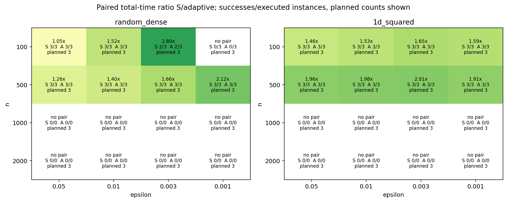
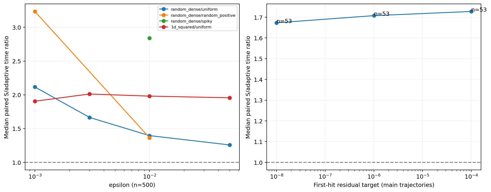
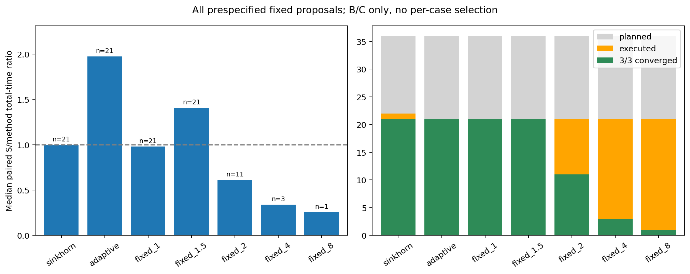
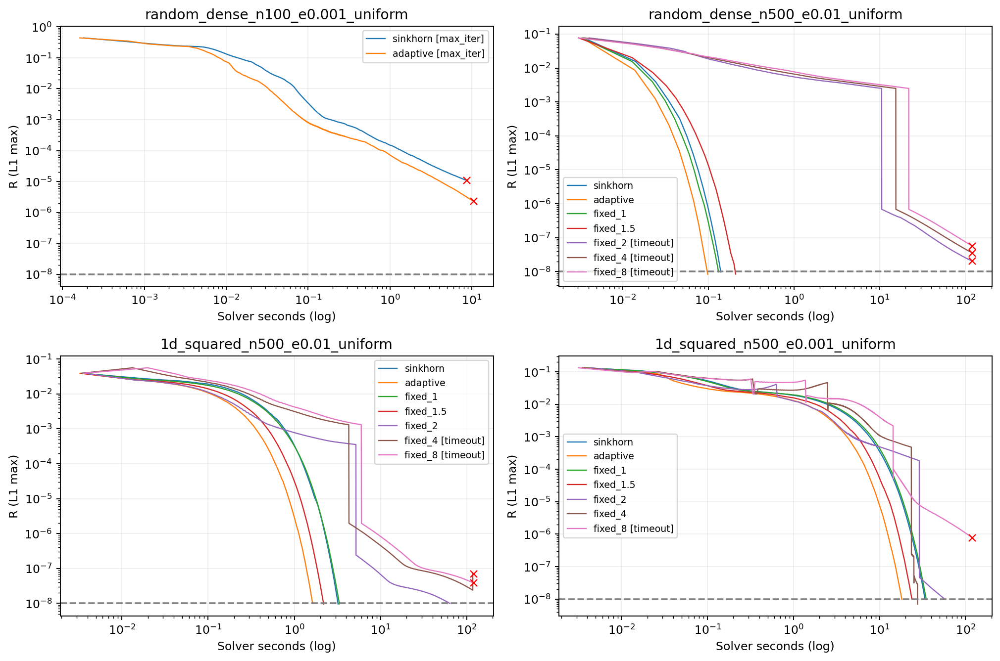
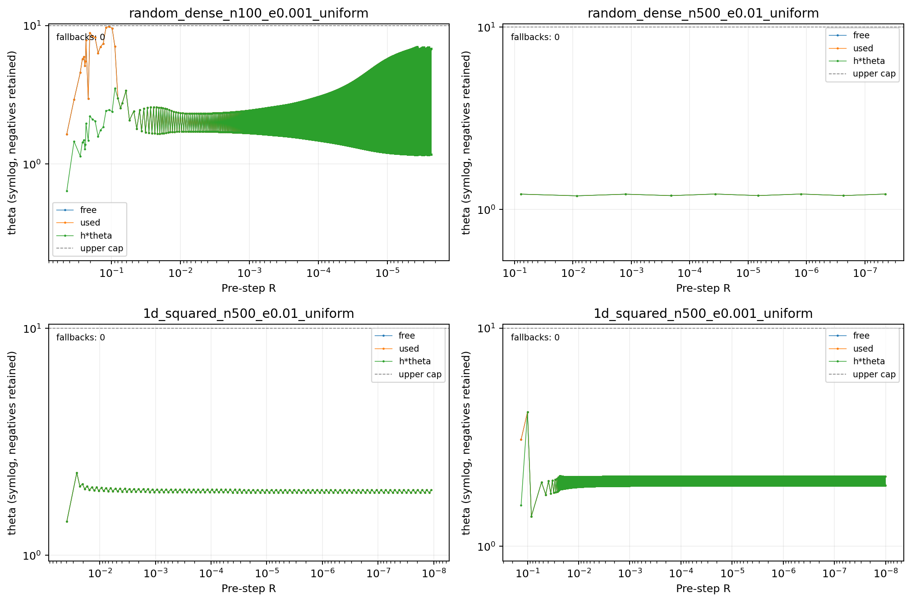
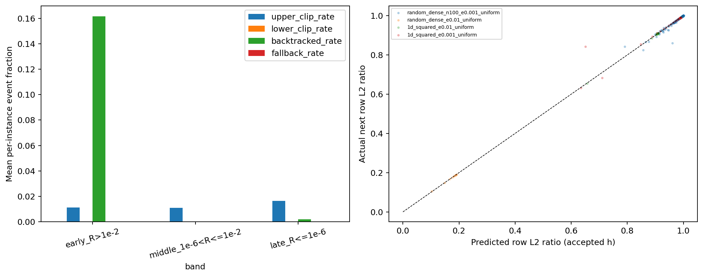

# θ 系统实验与固定 θ 消融

本报告只使用已保存的本轮实测数据；三次计时先在实例内取中位数，再跨实例汇总。

结果目录：[20260925_073951_550196_theta_balance_study_b8ea20](../results/20260925_073951_550196_theta_balance_study_b8ea20/)；[总体 CSV](../results/20260925_073951_550196_theta_balance_study_b8ea20/summary.csv)、[阈值 CSV](../results/20260925_073951_550196_theta_balance_study_b8ea20/thresholds.csv)、[共享索引](../results/20260925_073951_550196_theta_balance_study_b8ea20/manifest.json)。

## 实际覆盖与结论

| status | 正式重复次数 |
| --- | --- |
| converged | 513 |
| max_iter | 8 |
| pending | 636 |
| skipped_repeat | 114 |
| timeout | 49 |

| block | 计划组合 | 已启动 | 三次收敛 | 未收敛 | 计时未齐 | 尚未启动 |
| --- | --- | --- | --- | --- | --- | --- |
| smoke | 8 | 8 | 8 | 0 | 0 | 0 |
| A_small | 96 | 96 | 88 | 8 | 0 | 0 |
| B | 72 | 43 | 42 | 1 | 0 | 29 |
| C | 180 | 105 | 57 | 48 | 0 | 75 |
| A_large | 96 | 0 | 0 | 0 | 0 | 96 |
| D | 12 | 0 | 0 | 0 | 0 | 12 |

块覆盖按问题/方法组合计数。A/B 的重叠行引用同一批实测结果，不重复执行或重复计入总体样本数。

计划 440 个问题/方法组合（含原 pilot 回归、高精度）；已执行 228 个，三次均收敛 171 个。未执行不计为失败；确定性失败、max_iter 或 timeout 后不机械补齐其余重复。

主实验 Sinkhorn/自适应计划 120 个独立问题；主对照已执行 58 个，其中双方三次均收敛的 53 个问题中，自适应实际总时间获胜 53 个。这些配对时间比的中位数为 1.674×，范围 [1.041, 3.665]×。

以下精确时间比仅包含双方完整收敛的配对，成功数另列，不能据此掩盖失败或未执行。

三次完整收敛的组合中，有 28/171 个的最大/最小耗时比超过1.2，跨度最大为 6.9。原始三次时间保留在 CSV；接近1的速度比需结合这一波动解读。

已记录的正式求解累计 10364.7s，其中固定 θ 占 8729.5s （84.2%）；这些时间不含预热、公共初始化和文件读写。

## 本轮判断与未完成范围

**本次一小时续跑：**新增155次正式运行，其中135次收敛、20次超时；正式求解3355.5秒，含中断恢复的墙钟时间约3470.9秒，未超过3600秒。补齐了上次3项缺失计时，并完成9个新增非均匀边际问题的全部预设方法（超时分支按协议跳过其余重复）。累计570次正式运行：513收敛、8达到迭代上限、49超时。

**新增非均匀边际结论：**新增完整主对照均为 random_dense、n=500，每组3个种子。random_positive 在 ε=.01/.001 下的组内加速比中位数分别为1.364/3.234；spiky 在 ε=.01 下为2.839。9个新增完整配对全部由自适应获胜。这里的时间比先取各实例三次计时的中位数，再跨种子汇总。不同会话中的环境负载存在波动，边际间的幅度变化不能全部归因于边际本身。

**累计收益与边界：**53个完整主对照均由自适应获胜，配对时间比中位数1.674、范围1.041～3.665。均匀边际的原48个主实验未重跑：其中44个完整收敛配对的中位数仍为1.660；random_dense、n=100、ε=.05 仅约1.047，收益较弱。random_dense、n=100 的 ε=.003/seed=42 及 ε=.001/全部种子仍是两种方法均达到20000步但未达1e-8的4个问题。

**新增超时不能当作对照胜利：**最后启动的 random_dense、n=500、ε=.001、spiky、seed=42 中，Sinkhorn 在120秒后超时；相应自适应及固定 θ 尚未运行，因此不能据此断言自适应获胜或给出时间比。

**固定 θ 仍不能统一替代自适应：**B/C已有21个问题的固定方案被执行。θ=1、1.5 全部三次收敛；θ=2/4/8 分别有10/18/20个问题超时，完整收敛11/3/1个。每个固定值在其完整配对子集内均慢于自适应；θ=1.5 的21个配对中，自适应/固定时间比中位数为0.5879（约快1.70倍）。spiky、ε=.01 的 seed=2026 上，θ=4/8 能收敛但明显更慢，而另外两个种子超时，体现种子敏感性；不能逐题选择最优固定值后包装成无需调参的算法。θ=1仍只作GS整步和实现开销参照。

**保护机制：**累计57个已有自适应结果的主实验各取首条正式轨迹，共105830个接受步；上界截断160步、h<1为224步、下界截断1步、回退1步。更新前R≤1e-2的上界截断或缩步共有136步，来自新增非均匀边际，不能继续沿用原均匀样本“保护只在早期出现”的观察。唯一回退发生于 random_dense、n=500、ε=.01、spiky、seed=123 的第84步，更新前R约.003035、自由θ约−1.459e−12；负值原样保留，回退步hθ为不适用。分段比例、分位数和范围见下表。轨迹示例仍沿用原4个均匀样本，汇总统计包含新增样本。高低交替等现象只描述轨迹，不构成收敛定理。预测与真实缩减使用相同的行L2范数，不能替代L1停机指标。

**预算与恢复：**本次固定 θ 分支累计3056.7秒，占新增正式求解时间91.1%。运行中发生一次Windows原子替换检查点被拒绝；完整临时索引与逐次结果标记核对后恢复了1项未登记结果，没有重跑或丢弃已完成计时。入口只对PermissionError做有限重试，数值算法和源码指纹未变；修复及重启耗时计入同一小时截止时间。恢复进程使用剩余预算，索引保留各段预算与状态。正常续跑默认预算已恢复为3600秒。

**尚未完成：**636次正式重复待执行，另114次按失败/超时规则跳过，二者分开统计。待执行636次包括B/C余下非均匀边际312次、A的大规模n=1000/2000共288次、D的1e-10子集36次。B/C仍缺一维成本的两类非均匀边际，以及随机成本ε=.001的spiky剩余方法/种子。最后一个Sinkhorn超时样本的剩余2次重复属于跳过，不属于待执行。当前没有已成功但缺少计时重复的组合。原pilot的Dirichlet spiky仅作回归，不与新spiky定义混用。


## 规模与 ε（A，均匀边际）

| cost | n | epsilon | problems | 状态 | Sinkhorn成功 | 自适应成功 | 配对数 | 时间比中位数 | S秒 | A秒 | S迭代 | A迭代 | Sproxy | Aproxy |
| --- | --- | --- | --- | --- | --- | --- | --- | --- | --- | --- | --- | --- | --- | --- |
| 1d_squared | 100 | 0.001 | 3 | 已执行 | 3 | 3 | 3 | 1.594 | 0.9044 | 0.5493 | 3291 | 1623 | 2.633e+04 | 2.112e+04 |
| 1d_squared | 100 | 0.003 | 3 | 已执行 | 3 | 3 | 3 | 1.651 | 0.2683 | 0.1731 | 1098 | 538 | 8790 | 7005 |
| 1d_squared | 100 | 0.01 | 3 | 已执行 | 3 | 3 | 3 | 1.528 | 0.08581 | 0.05618 | 323 | 163 | 2590 | 2132 |
| 1d_squared | 100 | 0.05 | 3 | 已执行 | 3 | 3 | 3 | 1.457 | 0.01477 | 0.00966 | 61 | 32 | 494 | 423 |
| 1d_squared | 500 | 0.001 | 3 | 已执行 | 3 | 3 | 3 | 1.906 | 35.06 | 18.15 | 3040 | 1523 | 2.433e+04 | 1.981e+04 |
| 1d_squared | 500 | 0.003 | 3 | 已执行 | 3 | 3 | 3 | 2.012 | 10.91 | 5.512 | 1020 | 514 | 8166 | 6689 |
| 1d_squared | 500 | 0.01 | 3 | 已执行 | 3 | 3 | 3 | 1.981 | 3.216 | 1.629 | 308 | 156 | 2470 | 2037 |
| 1d_squared | 500 | 0.05 | 3 | 已执行 | 3 | 3 | 3 | 1.956 | 0.6202 | 0.3486 | 60 | 33 | 486 | 440 |
| 1d_squared | 1000 | 0.001 | 3 | 未执行 | 0 | 0 | 0 | — | — | — | — | — | — | — |
| 1d_squared | 1000 | 0.003 | 3 | 未执行 | 0 | 0 | 0 | — | — | — | — | — | — | — |
| 1d_squared | 1000 | 0.01 | 3 | 未执行 | 0 | 0 | 0 | — | — | — | — | — | — | — |
| 1d_squared | 1000 | 0.05 | 3 | 未执行 | 0 | 0 | 0 | — | — | — | — | — | — | — |
| 1d_squared | 2000 | 0.001 | 3 | 未执行 | 0 | 0 | 0 | — | — | — | — | — | — | — |
| 1d_squared | 2000 | 0.003 | 3 | 未执行 | 0 | 0 | 0 | — | — | — | — | — | — | — |
| 1d_squared | 2000 | 0.01 | 3 | 未执行 | 0 | 0 | 0 | — | — | — | — | — | — | — |
| 1d_squared | 2000 | 0.05 | 3 | 未执行 | 0 | 0 | 0 | — | — | — | — | — | — | — |
| random_dense | 100 | 0.001 | 3 | 已执行 | 0 | 0 | 0 | — | — | — | — | — | — | — |
| random_dense | 100 | 0.003 | 3 | 已执行 | 2 | 2 | 2 | 2.8 | 3.575 | 1.295 | 1.382e+04 | 3864 | 1.106e+05 | 5.024e+04 |
| random_dense | 100 | 0.01 | 3 | 已执行 | 3 | 3 | 3 | 1.52 | 0.1453 | 0.09558 | 90 | 45 | 726 | 592 |
| random_dense | 100 | 0.05 | 3 | 已执行 | 3 | 3 | 3 | 1.047 | 0.02198 | 0.02047 | 13 | 9 | 110 | 124 |
| random_dense | 500 | 0.001 | 3 | 已执行 | 3 | 3 | 3 | 2.116 | 37.21 | 13.54 | 2587 | 863 | 2.07e+04 | 1.123e+04 |
| random_dense | 500 | 0.003 | 3 | 已执行 | 3 | 3 | 3 | 1.665 | 0.5916 | 0.3575 | 54 | 32 | 438 | 423 |
| random_dense | 500 | 0.01 | 3 | 已执行 | 3 | 3 | 3 | 1.396 | 0.1443 | 0.1034 | 13 | 9 | 110 | 124 |
| random_dense | 500 | 0.05 | 3 | 已执行 | 3 | 3 | 3 | 1.258 | 0.05936 | 0.04719 | 5 | 4 | 46 | 59 |
| random_dense | 1000 | 0.001 | 3 | 未执行 | 0 | 0 | 0 | — | — | — | — | — | — | — |
| random_dense | 1000 | 0.003 | 3 | 未执行 | 0 | 0 | 0 | — | — | — | — | — | — | — |
| random_dense | 1000 | 0.01 | 3 | 未执行 | 0 | 0 | 0 | — | — | — | — | — | — | — |
| random_dense | 1000 | 0.05 | 3 | 未执行 | 0 | 0 | 0 | — | — | — | — | — | — | — |
| random_dense | 2000 | 0.001 | 3 | 未执行 | 0 | 0 | 0 | — | — | — | — | — | — | — |
| random_dense | 2000 | 0.003 | 3 | 未执行 | 0 | 0 | 0 | — | — | — | — | — | — | — |
| random_dense | 2000 | 0.01 | 3 | 未执行 | 0 | 0 | 0 | — | — | — | — | — | — | — |
| random_dense | 2000 | 0.05 | 3 | 未执行 | 0 | 0 | 0 | — | — | — | — | — | — | — |

## 边际与固定 θ（B/C）

| method | 计划问题 | 已执行 | 三次收敛 | 有效配对 | 时间比中位数 | 获胜数 | 成功耗时秒 | 成功迭代中位数 | 成功proxy中位数 |
| --- | --- | --- | --- | --- | --- | --- | --- | --- | --- |
| sinkhorn | 36 | 22 | 21 | 21 | 1 | 0 | 6 | 398 | 3190 |
| adaptive | 36 | 21 | 21 | 21 | 1.974 | 21 | 2.271 | 156 | 2037 |
| fixed_1 | 36 | 21 | 21 | 21 | 0.9799 | 6 | 6.061 | 398 | 4385 |
| fixed_1.5 | 36 | 21 | 21 | 21 | 1.407 | 15 | 4.024 | 265 | 2922 |
| fixed_2 | 36 | 21 | 11 | 11 | 0.6143 | 4 | 40.64 | 2890 | 3.181e+04 |
| fixed_4 | 36 | 21 | 3 | 3 | 0.3391 | 1 | 27.68 | 1543 | 2.199e+04 |
| fixed_8 | 36 | 21 | 1 | 1 | 0.2565 | 0 | 33.33 | 1290 | 2.395e+04 |

固定 θ=1 是 GS 整步核对及实现开销参照，不作为独立算法优势。每个固定值都保留成绩；固定的是提议 θ，Armijo 仍可改变 h，因此 θ=2/4/8 的 hθ 可能相同。没有逐题挑最优后包装成新方法。各方法的有效配对子集可能不同，须结合已执行数、完整收敛数判断稳定性。

额外选 θ 的代价是否值得，直接看自适应与各个全局固定值的配对：大于1表示固定值更快。

| method | 完整配对数 | 固定值更快的题数 | 自适应除以固定的时间比 | 最小比 | 最大比 |
| --- | --- | --- | --- | --- | --- |
| fixed_1 | 21 | 0 | 0.4889 | 0.2699 | 0.7687 |
| fixed_1.5 | 21 | 0 | 0.5879 | 0.3883 | 0.7904 |
| fixed_2 | 11 | 0 | 0.3179 | 0.01243 | 0.6793 |
| fixed_4 | 3 | 0 | 0.1194 | 0.05895 | 0.6555 |
| fixed_8 | 1 | 0 | 0.09036 | 0.09036 | 0.09036 |

| cost | epsilon | marginal | 状态 | 计划 | S成功 | A成功 | 配对 | 时间比 |
| --- | --- | --- | --- | --- | --- | --- | --- | --- |
| 1d_squared | 0.001 | random_positive | 未执行 | 3 | 0 | 0 | 0 | — |
| 1d_squared | 0.001 | spiky | 未执行 | 3 | 0 | 0 | 0 | — |
| 1d_squared | 0.001 | uniform | 已执行 | 3 | 3 | 3 | 3 | 1.906 |
| 1d_squared | 0.003 | uniform | 已执行 | 3 | 3 | 3 | 3 | 2.012 |
| 1d_squared | 0.01 | random_positive | 未执行 | 3 | 0 | 0 | 0 | — |
| 1d_squared | 0.01 | spiky | 未执行 | 3 | 0 | 0 | 0 | — |
| 1d_squared | 0.01 | uniform | 已执行 | 3 | 3 | 3 | 3 | 1.981 |
| 1d_squared | 0.05 | uniform | 已执行 | 3 | 3 | 3 | 3 | 1.956 |
| random_dense | 0.001 | random_positive | 已执行 | 3 | 3 | 3 | 3 | 3.234 |
| random_dense | 0.001 | spiky | 已执行 | 3 | 0 | 0 | 0 | — |
| random_dense | 0.001 | uniform | 已执行 | 3 | 3 | 3 | 3 | 2.116 |
| random_dense | 0.003 | uniform | 已执行 | 3 | 3 | 3 | 3 | 1.665 |
| random_dense | 0.01 | random_positive | 已执行 | 3 | 3 | 3 | 3 | 1.364 |
| random_dense | 0.01 | spiky | 已执行 | 3 | 3 | 3 | 3 | 2.839 |
| random_dense | 0.01 | uniform | 已执行 | 3 | 3 | 3 | 3 | 1.396 |
| random_dense | 0.05 | uniform | 已执行 | 3 | 3 | 3 | 3 | 1.258 |

## 精度与时间口径

1e-4/1e-6/1e-8 为完整轨迹首次命中时间，不是独立求解总时间。D 的协议设定为从同一公共初值重新完整运行至 1e-10（不是把后半段耗时当总时间）；共享输入/初值，单独标记 highprecision。实际执行状态如下。

| target | S至少一次命中 | A至少一次命中 | S三次命中 | A三次命中 | 配对数 | 时间比中位数 |
| --- | --- | --- | --- | --- | --- | --- |
| 1e-08 | 53 | 53 | 53 | 53 | 53 | 1.673 |
| 1e-06 | 54 | 54 | 53 | 53 | 53 | 1.708 |
| 0.0001 | 58 | 57 | 53 | 53 | 53 | 1.728 |

| cost | marginal | method | status | elapsed_sec | n_iter | residual_l1 |
| --- | --- | --- | --- | --- | --- | --- |
| random_dense | uniform | sinkhorn | pending | — | — | — |
| random_dense | uniform | adaptive | pending | — | — | — |
| random_dense | random_positive | sinkhorn | pending | — | — | — |
| random_dense | random_positive | adaptive | pending | — | — | — |
| random_dense | spiky | sinkhorn | pending | — | — | — |
| random_dense | spiky | adaptive | pending | — | — | — |
| 1d_squared | uniform | sinkhorn | pending | — | — | — |
| 1d_squared | uniform | adaptive | pending | — | — | — |
| 1d_squared | random_positive | sinkhorn | pending | — | — | — |
| 1d_squared | random_positive | adaptive | pending | — | — | — |
| 1d_squared | spiky | sinkhorn | pending | — | — | — |
| 1d_squared | spiky | adaptive | pending | — | — | — |

## θ 与保护机制

每步 θ/h 与更新前 R 对齐；残差分段为 R>1e-2、1e-6<R≤1e-2、R≤1e-6。summary.csv 保存每条轨迹各段的 min/q10/median/q90/max 和截断/回溯/回退比例。下表先逐实例计算再取中位数，每个实例只用首条正式轨迹，避免把计时重复当独立样本。

| band | 实例数 | free q10 | free q50 | free q90 | θ中位数 | hθ中位数 | 上截断率 | 下截断率 | h<1比例 | 回退率 |
| --- | --- | --- | --- | --- | --- | --- | --- | --- | --- | --- |
| early_R>1e-2 | 57 | 1.539 | 1.888 | 2.099 | 1.888 | 1.562 | 0 | 0 | 0 | 0 |
| middle_1e-6<R<=1e-2 | 57 | 1.387 | 1.7 | 2.093 | 1.7 | 1.7 | 0 | 0 | 0 | 0 |
| late_R<=1e-6 | 54 | 1.431 | 1.897 | 2.075 | 1.897 | 1.897 | 0 | 0 | 0 | 0 |

比例以0～1表示。各残差段参与实例数不同，尚未到达后期的实例不进入后期统计。

所有已记录主实验方向的 θ_free 范围为 [-1.4588e-12, 64.9605]，截断 θ 范围 [0, 10]，非回退 hθ 范围 [2.32269e-13, 10]。

预测值是 ||r−hθs||₂/||r||₂，真实值是 ||r_next||₂/||r||₂；η 对应 h=1 的线性预测。这些量不能直接解释 L1 停止指标。固定分支不计算 qS、s、θ_free、η 或预测比，空值表示不适用。回退的 hθ 为空；负 θ_free 原样保留；失败试步原因保存在 summary 的事件记录。

## 失败、超时、最慢与未执行

| label | method | repeat | status | stop_reason | elapsed_sec | residual_l1 |
| --- | --- | --- | --- | --- | --- | --- |
| random_dense_n100_e0.003_uniform_s42 | sinkhorn | 1 | max_iter | max_iter | 33.63 | 8.954e-07 |
| random_dense_n100_e0.003_uniform_s42 | adaptive | 1 | max_iter | max_iter | 37.24 | 1.358e-07 |
| random_dense_n100_e0.001_uniform_s42 | sinkhorn | 1 | max_iter | max_iter | 8.682 | 1.086e-05 |
| random_dense_n100_e0.001_uniform_s42 | adaptive | 1 | max_iter | max_iter | 10.55 | 2.304e-06 |
| random_dense_n100_e0.001_uniform_s123 | sinkhorn | 1 | max_iter | max_iter | 8.14 | 4.173e-06 |
| random_dense_n100_e0.001_uniform_s123 | adaptive | 1 | max_iter | max_iter | 9.611 | 1.27e-06 |
| random_dense_n100_e0.001_uniform_s2026 | sinkhorn | 1 | max_iter | max_iter | 8.127 | 6.344e-06 |
| random_dense_n100_e0.001_uniform_s2026 | adaptive | 1 | max_iter | max_iter | 9.716 | 1.808e-06 |
| random_dense_n500_e0.01_uniform_s42 | fixed_2 | 1 | timeout | timeout | 120 | 2.021e-08 |
| random_dense_n500_e0.01_uniform_s42 | fixed_4 | 1 | timeout | timeout | 120 | 3.538e-08 |
| random_dense_n500_e0.01_uniform_s42 | fixed_8 | 1 | timeout | timeout | 120 | 5.668e-08 |
| random_dense_n500_e0.01_uniform_s123 | fixed_2 | 1 | timeout | timeout | 120 | 1.201e-08 |
| random_dense_n500_e0.01_uniform_s123 | fixed_4 | 1 | timeout | timeout | 120 | 6.768e-08 |
| random_dense_n500_e0.01_uniform_s123 | fixed_8 | 1 | timeout | timeout | 120 | 3.323e-08 |
| random_dense_n500_e0.01_uniform_s2026 | fixed_2 | 1 | timeout | timeout | 120 | 2.194e-08 |
| random_dense_n500_e0.01_uniform_s2026 | fixed_4 | 1 | timeout | timeout | 120 | 4.748e-08 |
| random_dense_n500_e0.01_uniform_s2026 | fixed_8 | 1 | timeout | timeout | 120 | 7.559e-08 |
| random_dense_n500_e0.001_uniform_s42 | fixed_4 | 1 | timeout | timeout | 120 | 2.115e-06 |
| random_dense_n500_e0.001_uniform_s42 | fixed_8 | 1 | timeout | timeout | 120 | 6.515e-06 |
| random_dense_n500_e0.001_uniform_s123 | fixed_2 | 1 | timeout | timeout | 120 | 1.075e-07 |
| random_dense_n500_e0.001_uniform_s123 | fixed_4 | 1 | timeout | timeout | 120 | 2.045e-05 |
| random_dense_n500_e0.001_uniform_s123 | fixed_8 | 1 | timeout | timeout | 120 | 2.041e-05 |
| random_dense_n500_e0.001_uniform_s2026 | fixed_2 | 1 | timeout | timeout | 120 | 1.681e-08 |
| random_dense_n500_e0.001_uniform_s2026 | fixed_4 | 1 | timeout | timeout | 120 | 2.61e-06 |
| random_dense_n500_e0.001_uniform_s2026 | fixed_8 | 1 | timeout | timeout | 120 | 3.419e-06 |
| 1d_squared_n500_e0.01_uniform_s42 | fixed_4 | 1 | timeout | timeout | 120 | 6.896e-08 |
| 1d_squared_n500_e0.01_uniform_s42 | fixed_8 | 1 | timeout | timeout | 120 | 3.805e-08 |
| 1d_squared_n500_e0.01_uniform_s123 | fixed_4 | 1 | timeout | timeout | 120 | 5.684e-08 |
| 1d_squared_n500_e0.01_uniform_s123 | fixed_8 | 1 | timeout | timeout | 120 | 9.838e-08 |
| 1d_squared_n500_e0.01_uniform_s2026 | fixed_4 | 1 | timeout | timeout | 120 | 2.299e-08 |
| 1d_squared_n500_e0.01_uniform_s2026 | fixed_8 | 1 | timeout | timeout | 120 | 2.482e-05 |
| 1d_squared_n500_e0.001_uniform_s42 | fixed_8 | 1 | timeout | timeout | 120 | 7.731e-07 |
| 1d_squared_n500_e0.001_uniform_s123 | fixed_2 | 1 | timeout | timeout | 120 | 1.048e-08 |
| 1d_squared_n500_e0.001_uniform_s123 | fixed_4 | 1 | timeout | timeout | 120 | 1.381e-06 |
| 1d_squared_n500_e0.001_uniform_s123 | fixed_8 | 1 | timeout | timeout | 120 | 4.945e-06 |
| 1d_squared_n500_e0.001_uniform_s2026 | fixed_4 | 1 | timeout | timeout | 120 | 3.345e-05 |
| 1d_squared_n500_e0.001_uniform_s2026 | fixed_8 | 1 | timeout | timeout | 120 | 4.06e-08 |
| random_dense_n500_e0.01_random_positive_s42 | fixed_2 | 1 | timeout | timeout | 120 | 6.761e-08 |
| random_dense_n500_e0.01_random_positive_s42 | fixed_4 | 1 | timeout | timeout | 120 | 1.256e-07 |
| random_dense_n500_e0.01_random_positive_s42 | fixed_8 | 1 | timeout | timeout | 120 | 1.353e-06 |
| random_dense_n500_e0.01_random_positive_s123 | fixed_2 | 1 | timeout | timeout | 120 | 6.65e-07 |
| random_dense_n500_e0.01_random_positive_s123 | fixed_4 | 1 | timeout | timeout | 120 | 8.138e-07 |
| random_dense_n500_e0.01_random_positive_s123 | fixed_8 | 1 | timeout | timeout | 120 | 9.368e-07 |
| random_dense_n500_e0.01_random_positive_s2026 | fixed_2 | 1 | timeout | timeout | 120 | 1.649e-07 |
| random_dense_n500_e0.01_random_positive_s2026 | fixed_4 | 1 | timeout | timeout | 120 | 2.369e-07 |
| random_dense_n500_e0.01_random_positive_s2026 | fixed_8 | 1 | timeout | timeout | 120 | 3.055e-07 |
| random_dense_n500_e0.01_spiky_s42 | fixed_4 | 1 | timeout | timeout | 120 | 3.817e-08 |
| random_dense_n500_e0.01_spiky_s42 | fixed_8 | 1 | timeout | timeout | 120 | 3.41e-07 |
| random_dense_n500_e0.01_spiky_s123 | fixed_4 | 1 | timeout | timeout | 120 | 1.316e-07 |
| random_dense_n500_e0.01_spiky_s123 | fixed_8 | 1 | timeout | timeout | 120 | 1.627e-07 |
| random_dense_n500_e0.001_random_positive_s42 | fixed_2 | 1 | timeout | timeout | 120 | 1.571e-06 |
| random_dense_n500_e0.001_random_positive_s42 | fixed_4 | 1 | timeout | timeout | 120 | 2.17e-08 |
| random_dense_n500_e0.001_random_positive_s42 | fixed_8 | 1 | timeout | timeout | 120 | 6.041e-08 |
| random_dense_n500_e0.001_random_positive_s123 | fixed_8 | 1 | timeout | timeout | 120 | 1.523e-08 |
| random_dense_n500_e0.001_random_positive_s2026 | fixed_4 | 1 | timeout | timeout | 120 | 5.509e-07 |
| random_dense_n500_e0.001_random_positive_s2026 | fixed_8 | 1 | timeout | timeout | 120 | 5.528e-07 |
| random_dense_n500_e0.001_spiky_s42 | sinkhorn | 1 | timeout | timeout | 120 | 2.823e-05 |

耗时最长的十个已执行问题/方法组合（实例内中位数）：

| label | method | status | elapsed_sec | n_iter | residual_l1 |
| --- | --- | --- | --- | --- | --- |
| random_dense_n500_e0.001_uniform_s42 | fixed_8 | skipped_repeat,timeout | 120 | 3577 | 6.515e-06 |
| random_dense_n500_e0.001_uniform_s123 | fixed_8 | skipped_repeat,timeout | 120 | 3641 | 2.041e-05 |
| random_dense_n500_e0.001_uniform_s2026 | fixed_8 | skipped_repeat,timeout | 120 | 3480 | 3.419e-06 |
| random_dense_n500_e0.001_random_positive_s42 | fixed_8 | skipped_repeat,timeout | 120 | 3482 | 6.041e-08 |
| random_dense_n500_e0.01_uniform_s123 | fixed_8 | skipped_repeat,timeout | 120 | 4814 | 3.323e-08 |
| random_dense_n500_e0.01_spiky_s123 | fixed_8 | skipped_repeat,timeout | 120 | 4545 | 1.627e-07 |
| random_dense_n500_e0.001_uniform_s123 | fixed_2 | skipped_repeat,timeout | 120 | 8314 | 1.075e-07 |
| 1d_squared_n500_e0.01_uniform_s42 | fixed_8 | skipped_repeat,timeout | 120 | 4999 | 3.805e-08 |
| 1d_squared_n500_e0.01_uniform_s2026 | fixed_8 | skipped_repeat,timeout | 120 | 5157 | 2.482e-05 |
| random_dense_n500_e0.001_random_positive_s42 | fixed_4 | skipped_repeat,timeout | 120 | 4759 | 2.17e-08 |

尚未执行正式重复数：636；具体标签、方法和重复号见 summary.csv 的 pending 行。

## 配置、环境与复现

环境 `D:\miniconda_envs\OT\python.exe`；Python 3.9.24，NumPy 2.0.2，SciPy 1.13.1。CPU float64，BLAS 单线程；基础 commit `94db3aa0cb15550454b5d1ae82540638664f6fb2`，源码指纹 `033f5de7695153f52b641f6c81e4c35225fabd622cc46a824ef6311d320fbcf1`。

最大尺寸 2000，按 12 个稠密 float64 数组保守估计 366.2 MiB（非峰值实测，不含解释器/绘图）。串行运行，不保存每步 P。

成本复用原生成器并除以原最大值，原尺度、成本/边际/问题/初值指纹保存于 CSV/manifest。uniform、独立 Uniform(.1,1) 归一化、2% 位置分配90%质量的 spiky 为本轮边际；与旧 pilot 的 Dirichlet 边际不同，回归块单列。seeds=42/123/2026。

主容差 1e-08、max_iter=20000、每次 120 秒迭代边界上限，本会话预算 3600 秒；预算尾部不足一次完整上限时不启动新运行。θ_max=10，h初值1，Armijo=1e-4，收缩.5，最多60次回溯。每个方法20步/2秒有界预热，正式三次，方法顺序交替；重启进程重新预热。双方同一公共 GS 初值，初始化单列。

总时间含内部初始化、方向、全部试步、正性/Armijo、列更新、回退、共同监控、最终诊断；不含公共 GS、保存和绘图。两边逐步记录且关闭谱/SVD。成绩是当前统一监控框架内的性能。diagnostic_sec 继承旧格式，只累计谱诊断，本轮为0不代表共同监控没有成本。dense-pass proxy 为 P构造+全矩阵归约+LSE+P向量乘的未加权计数，不是 FLOPs 或等价 matvec；最终 transport objective、向量算术和分配不计入 proxy，但计入总时间。

累计输入处理及逐次结果写入时间约 63.756s（不含索引检查点写入，另列）；本次分析/绘图耗时见 manifest.analysis_sec。全体运行保留配置和运行环境；同问题只存一份输入。断点续跑按问题、初值、solver配置和源码指纹校验。

主运行命令：

```powershell
.\scripts\run_ot.cmd scripts/run_theta_balance_pilot.py --config configs/theta_balance_study.yaml
```

同一目录续跑 / 仅分析：

```powershell
.\scripts\run_ot.cmd scripts/run_theta_balance_pilot.py --resume D:/sinkhorn-lmflow/results/20260925_073951_550196_theta_balance_study_b8ea20
.\scripts\run_ot.cmd scripts/run_theta_balance_pilot.py --analyze D:/sinkhorn-lmflow/results/20260925_073951_550196_theta_balance_study_b8ea20
```

续跑默认使用索引中的原配置。需要更改本次预算时，只修改同一 YAML 的 budget_sec，并在 --resume 命令后添加 --config configs/theta_balance_study.yaml；数值协议改动会被拒绝。

没有矩形、真实数据、GPU 或额外文献基线。本轮不改变算法及保护规则，不把相关性写成普遍定理。

## 保存结果复核

已复核 570 份正式结果、62 份共享输入；219 份固定 θ 运行的 p_matvec_count 全为0，选参诊断全为空。首轮正式结果最终列 L1 残差最大 5.93e-15。前后残差对齐、成本/边际切片不变性和原 pilot 迭代数均通过检查。

元数据修正：259 份 runtime_metadata 最初继承了总控 seed=42，现已按共享问题的实际 seed 更正；问题数据、轨迹、状态和计时均未改动。

## 验证与文件改动

`scripts/run_ot.cmd -m pytest -q`：71项测试通过。新增验证覆盖固定分支跳过选参矩阵乘、GS整步与阻尼步的区别、列归一化、输入/初值指纹、ε和边际切片不变性、超时/失败/待执行区分、预算续跑和旧结果读取。保存结果另经全量核对；六张汇总图已逐张检查。`git diff --check`通过。

| 文件 | 本轮改动理由 |
| --- | --- |
| `scripts/run_theta_balance_pilot.py` | 保留默认pilot入口；加入study分块、配置/初值指纹、单目录续跑、预算、汇总和六张图。 |
| `src/sinkhorn_lmflow/solvers/theta_balance.py` | 同一solver增加固定θ可选分支，跳过qS/s/自由θ/η计算；复用试步，记录预测L2比和超时。 |
| `src/sinkhorn_lmflow/solvers/sinkhorn.py` | 加入相同的迭代边界时间上限。 |
| `src/sinkhorn_lmflow/solvers/base.py` | 复用原行归约记录前后残差与实际行L2比；提供共同超时检查。 |
| `src/sinkhorn_lmflow/types.py` | 增加有默认值的配置和诊断字段，兼容旧结果。 |
| `src/sinkhorn_lmflow/problems/generators.py` | 仅增加原成本最大值元数据；旧生成器的数学输入不变。 |
| `tests/test_theta_balance.py` | 在原文件追加必要验证。 |
| `configs/theta_balance_study.yaml`（新增） | 唯一完整实验配置。 |
| `docs/theta_balance_study.md`（新增） | 唯一主报告；CSV和manifest为数据源。 |

本轮7个已跟踪文件的 `git diff --stat -- scripts/run_theta_balance_pilot.py src/sinkhorn_lmflow tests/test_theta_balance.py` 如下；新增配置和本报告尚未跟踪，不包含在这项stat内。工作区原有notes改动及暂存区保留，运行产物集中在上述结果目录。

```text
 scripts/run_theta_balance_pilot.py           | 731 ++++++++++++++++++++++++++-
 src/sinkhorn_lmflow/problems/generators.py   |   3 +-
 src/sinkhorn_lmflow/solvers/base.py          |  19 +-
 src/sinkhorn_lmflow/solvers/sinkhorn.py      |   3 +
 src/sinkhorn_lmflow/solvers/theta_balance.py |  25 +-
 src/sinkhorn_lmflow/types.py                 |  10 +
 tests/test_theta_balance.py                  | 123 +++++
 7 files changed, 902 insertions(+), 12 deletions(-)
```


本次续跑后再次运行71项测试，全部通过；另用临时目录注入短暂/持续PermissionError，验证有限重试、原索引保留及未提交临时索引保留。全量570份结果和62份共享输入完成审计。求解器源码不变；本次代码只增加检查点写入重试，YAML默认预算改为3600秒。恢复脚本与核查记录集中在结果目录的scratch中。


## 总体图

代表曲线为 seed=42 的首条正式轨迹，展示随机成本 n=100/ε=.001 与 n=500/ε=.01，一维成本 n=500/ε=.01 与 .001，均为 uniform。此处按已观测的快速、缓慢及未收敛情形选图，总体统计仍保留全部实例。未执行的方法不补曲线。时间统计先取实例内三次中位数。保护率柱图先按实例计算比例再求均值，正文分段表取实例中位数。












