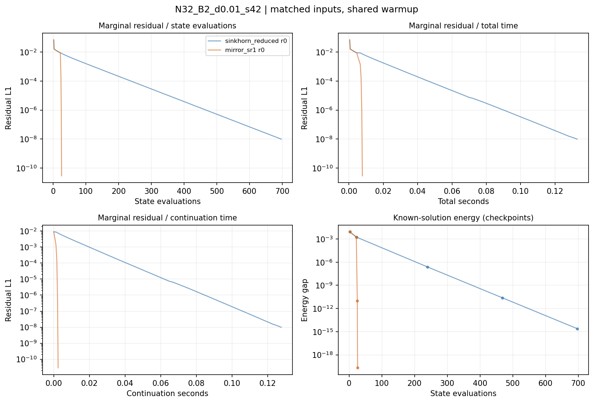
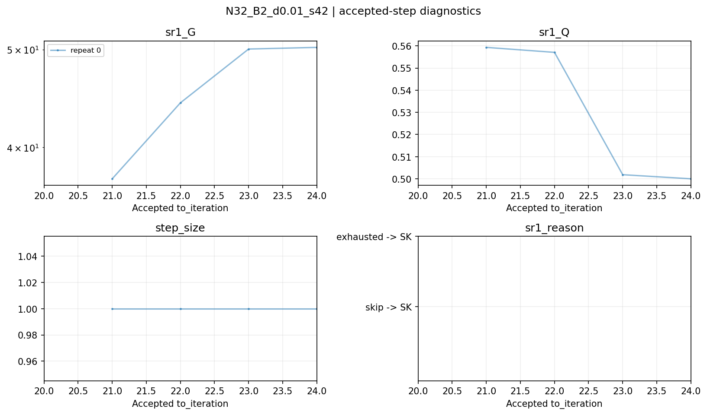

# SR1 v0 smoke 结果

计划 1 个 case × repeat 配对；状态：{'completed': 1, 'partial': 0, 'pending': 0}。所有 attempt、失败和 pending 保留在 all_runs.csv。

方法共用行归一化观测位置与 20 次 Sinkhorn 预热。受控种子仅改变初值；重复编号仅用于计时。
时间包含方向、试探和诊断，排除保存与绘图；双方各承担一次共享预热。state_eval_count 包含已知参考态的一次诊断评估。
稳定目标差每次单独计数；能量仅在初始、预热末、首次跨越阈值和 max_iter 检查点计算。稠密遍历代理不是 FLOPs。
Bregman 核仅在数值评估中重新归一化行条件分布；实际 P、边际和停止容差不变。未使用 roundoff_residual 接受。

## 最终阈值 1e-8

| case | 方法 | 成功/已运行 | 迭代中位数 | 评估中位数 | 目标差核中位数 | 总秒中位数 [最小,最大] | 后期秒中位数 |
|---|---|---:|---:|---:|---:|---:|---:|
| N32_B2_d0.01_s42 | mirror_sr1 | 1/1 | 24 | 26 | 24 | 0.007784 [0.007784, 0.007784] | 0.002447 |
| N32_B2_d0.01_s42 | sinkhorn_reduced | 1/1 | 695 | 697 | 695 | 0.133 [0.133, 0.133] | 0.1276 |

有效配对的最终总时间比 T_SK/T_SR1：中位数、最小、最大 = ('17.08', '17.08', '17.08')。预热已达阈值或任一失败的配对不报告加速倍数。

## 诊断与限制

G、Q 和夹角对应真正接受的 SR1 步，记录在终点行，from_iteration 指向起点。回退行不复用已拒绝方向的预测值。
有效方向的同点耗散关系不是整条离散轨道加速定理；实际收益须同时看评估数、额外目标差核和时间。
所有阈值均取同一轨道首次接受状态；初始已达阈值记零时间。缺失值不是零成本。
图中红叉标记非收敛终点；能量图仅绘制有效正值，不裁剪非正能量。完整值在 history.csv。

[全部运行](tables/all_runs.csv) · [阈值成本](tables/threshold_costs.csv) · [中位数及范围](tables/threshold_summary.csv) · [配对比值](tables/paired_speedups.csv) · [保护统计](tables/sr1_events.csv)

## 数值诊断摘要

最新 attempt 的 SR1 事件汇总：`{'attempts': 4, 'valid': 4, 'accepted': 4, 'fallbacks': 0, 'skips': 0, 'exhausted': 0, 'rejected': 0}`。

合法方向比例 100.00%，接受比例 100.00%，SK 回退比例 0.00%。

跳过原因合计：`{}`。

| case | 接受步 G 中位数的中位数 | 接受步 Q 中位数的中位数 | 最小接受步长 |
|---|---:|---:|---:|
| N32_B2_d0.01_s42 | 47.17 | 0.5295 | 1 |

以上 G/Q 只统计接受的 SR1 步；跳过或耗尽后的 Sinkhorn 步不使用失败方向的预测量。
若 G 大而 Q 小、步长缩小，说明同点增益未完全转化为有限步下降；最终成本比判断额外工作是否抵消收益。

## 图表

### N32_B2_d0.01_s42

## 复现与恢复

` .\scripts\run_ot.cmd scripts/run_sr1_study.py --config "results\20261110_115315_248788_sr1_smoke_0a8dad/study_config.yaml" `

`.\scripts\run_ot.cmd scripts/run_sr1_study.py --config "results\20261110_115315_248788_sr1_smoke_0a8dad/study_config.yaml" --resume "results\20261110_115315_248788_sr1_smoke_0a8dad"`

`.\scripts\run_ot.cmd scripts/report_sr1.py --run-dir "results\20261110_115315_248788_sr1_smoke_0a8dad"`

恢复检查配置、数学输入、初值指纹，跳过有完整产物的成功配对；未完成或失败配对新增 attempt，保留旧结果。
初值目录使用 SHA256 前 16 位防止 Windows 长路径，metadata 保存并核对完整 SHA256；不同问题的完整初始势分开保存。
