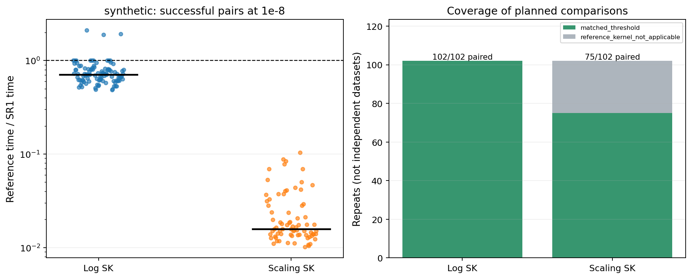
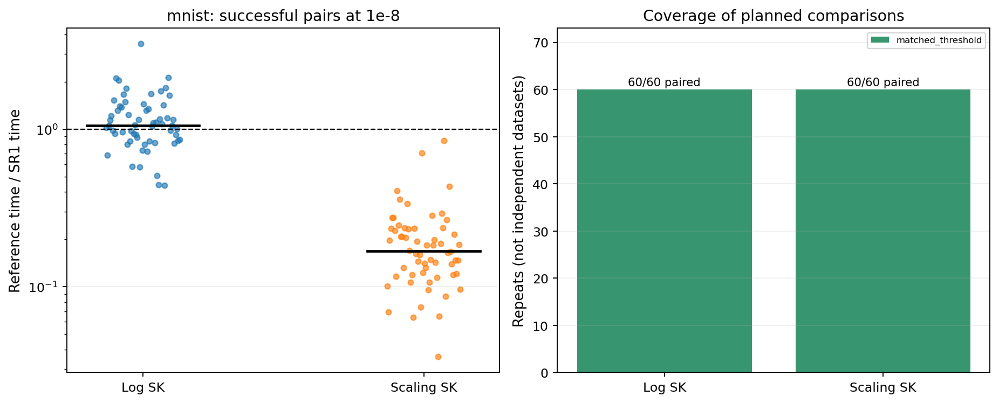
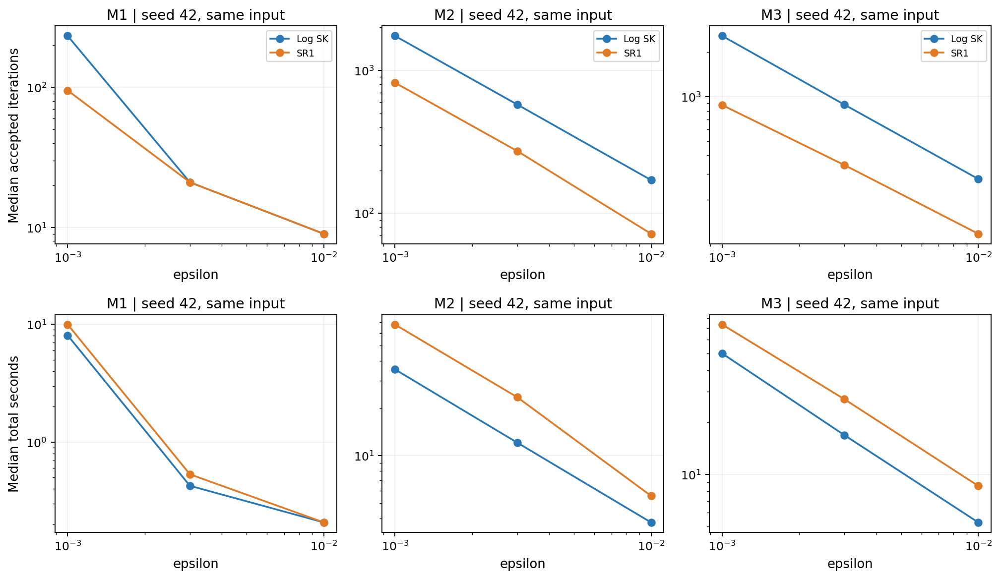
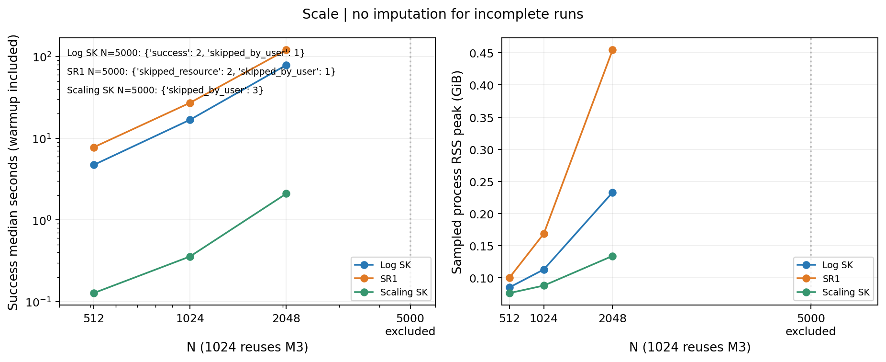
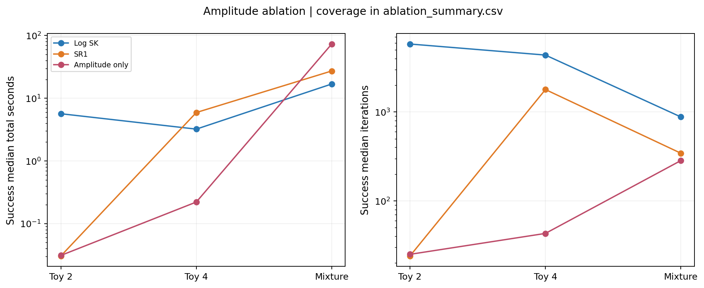
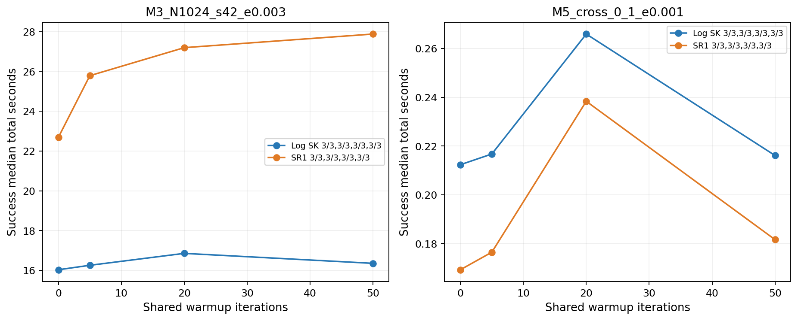
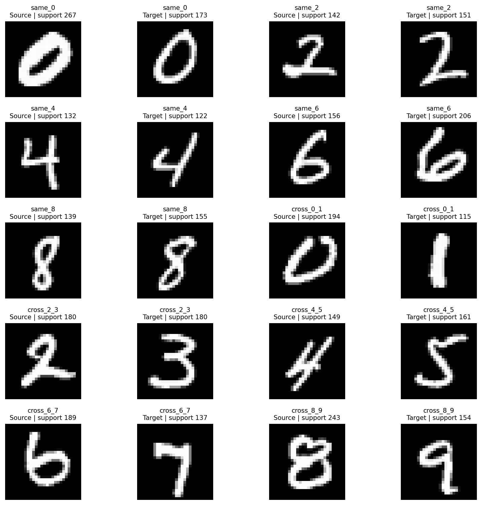

# SR1 v1 主流基准：阶段结果

本轮实现没有显示 SR1 的普遍墙钟优势：普通合成的 log SK/SR1 时间比中位数为 0.7098；MNIST 在 ε=0.01 时为 1.274，在 ε=0.001 时为 0.9131。比值大于 1 才表示 SR1 更快，收益依赖具体输入与正则强度。调整后的计划剩余 pending 为 0；原计划中 N=5000 的排除与未达标轨道保留在覆盖统计中。

按用户后续要求，N=5000 在 SR1 资源检查未通过后停止剩余方法比较；已完成的单方法结果仅归档，不纳入配对收益。用户取消与算法失败分开计数。

本轮计划 607 条轨道，当前状态为 `{'success': 567, 'skipped_resource': 2, 'skipped_by_user': 5, 'not_applicable_kernel_underflow': 27, 'library_stop': 6}`。主比较在 1e-8 精度有 168/171 个成功配对；其中 9 个配对在共享预热内完成，不归因于 SR1；其余按重复轨道计，SR1 快于轻量 log SK 的有 38 个，慢于它的有 121 个。成功配对时间比中位数为 0.7962，范围 0.4399–3.485。该汇总仅作为覆盖概览；普通合成、图像和 toy 的结论分别见下表，三个计时重复不是独立数据样本。

## 方法、计时与冻结约束

SR1 保持 v0 的单对正分母更新：每步采用当前 B0，只使用最近两个真实接受状态；要求 d>0 且相对分母至少 1e-8。固定六个步长 1, 1/2, …, 1/32，稳定目标差 Armijo，失败即单位 SK 回退。没有多历史、谱预条件或新的外层加速。

主基线 sk_log_fast 使用缓存 log 核、行/列 logsumexp，在行归一化端点观测残差，不构造 P、完整目标差或 Bregman。SR1 在分叉处为自己的方向构造一次所需状态，费用记入该方法。sk_scaling_fast 从零势冷启动，exp 核的构造计费；核含零即 not_applicable_kernel_underflow，不截断或改变成本。L-BFGS 使用同一半对偶、末坐标固定为零的 m−1 变量，maxcor=20、maxls=50、ftol=0、gtol=0，以统一边际残差验收；library_stop 不能代替成功，没有 SK 收尾。

默认先共享最多 20 步真实轻量 SK，并向每种方法计入预热费用；机器账本只收取共享预热一次。提前达到 1e-8 就直接结束，共享预热内的阈值命中不解释为 SR1 的加速。总时间=warmup+post，setup 已包含在其中，不能再次相加。普通分叉轨道 setup 是 post 的子集；预热内收敛的 setup 来自预热，属于 warmup。阈值成本来自同一轨道首次命中，终点容差包括最终导出开销。性能与诊断单独计时；数据准备、输入哈希、写盘、独立审计不计入算法时间，manifest 另存这些开销。state_eval 在不同内核间不等价；实际 logsumexp、matvec、P 构造、目标差和梯度次数单列，dense_pass_proxy 不用于跨内核比较。objective_gradient_count 专指 L-BFGS 显式目标/梯度 oracle 调用；SR1 在其稠密 state_eval 中同步计算 f 和 c−b，不把该字段为零解释为没有计算目标或梯度。matrix_vector_count 对新增缩放核记录 K@v 与 K.T@u；SR1 的每个正常 Bregman 调用另含一次条件均值矩阵向量乘法，包含于 bregman_count。该字段为零不能解释为 SR1 没有矩阵向量运算。

## 输入、环境与预算

M1 为满秩 U(0,1) 随机成本；M2 为独立二维均匀点云；M3 为文档固定三团混合高斯；M4 保持 M3 几何但用独立 Dirichlet(1/0.1) 边际，无质量地板。M1–M4 为 1024×1024；M1–M3 使用 ε=0.01/0.003/0.001、种子 42/43/44。M4 用 ε=0.003。M6 为 N=512/1024/2048/5000，1024 复用 M3，同一个 5000 点源/目标池取前缀；M7 为 1024×2048。几何、成本和两侧权重使用独立 SeedSequence 流，改变 ε 或边际不改变点池。合成成本除以各实例原始最大值。

MNIST 来自 [CVDF 官方镜像](https://github.com/cvdfoundation/mnist) 的测试集。配对在求解前以种子 20261110 固定：同类 0/2/4/6/8 和跨类 0–1/2–3/4–5/6–7/8–9，共 20 张不同图像；以原始灰度作质量，删除精确零支持，像素坐标除以 27，平方欧氏成本固定除以完整网格直径平方 2。每对 ε=0.01/0.001；原始索引、掩码、质量、原图和文件 SHA256 均已保存。

- Python：`3.9.24 (main, Oct 14 2025, 16:10:39) [MSC v.1929 64 bit (AMD64)]`；解释器：`D:\miniconda_envs\OT\python.exe`。
- NumPy 2.0.2 / SciPy 1.13.1；CPU：Intel64 Family 6 Model 183 Stepping 1, GenuineIntel；OS：Windows-10-10.0.26200-SP0。
- 基础提交 `0481d2f478c7302860cc6b42041ba244909d8152`，dirty=True；求解实现指纹 `96405a9bce27108a5e3e2d972ca752046a6866ac64e0bb46f2fa593bc0b42c2b`。
- 启动可用内存 3.860 GiB，运行限制 2.316 GiB（min(8 GiB, 60% 可用内存)）。
- 性能机器预算已用 6945.6/21600 秒；诊断 75.2/3600 秒。
- 中断恢复的保守补计费用合计 114.335 秒，已包含在累计预算中；它是防止恢复重置预算的上界记账，不是精确算法时间，不进入成功轨道的时间比。
- 各次调用的启动内存上限与环境保存在 manifest.invocations；本表环境为最后一次调用，逐轨道原始环境仍各自保留。桌面后台负载与频率未隔离，三次重复的范围不代表置信区间。
- 单轨道维数≤2048 时 300 秒，否则 1200 秒；最多 50000 步、统一 tol=1e-8。数值内核之间检查限时，单次内核可能轻微越界。
- 内存记录为每 50 ms 抽样的进程 RSS 峰值，是瞬时峰值的下界；另保存保守工作区估计。资源跳过单列，未改小 N。

## 主结果：按族、精度和边际分开

表内时间比为 log SK 总时间 / SR1 总时间，仅对双方成功且输入、预热匹配的配对计算。小于 1 即 SR1 更慢。中位数与极值仅为描述统计，不是显著性或置信区间。主表不含 toy。

| 族 | ε | α | SR1 成功/计划 | SK 成功/计划 | 成功配对 | 时间比中位数 [范围] |
|---|---:|---:|---:|---:|---:|---|
| M1 | 0.01 | — | 9/9 | 9/9 | 9 | 0.9999 [0.9997–1.004] |
| M1 | 0.003 | — | 9/9 | 9/9 | 9 | 0.8073 [0.7287–0.954] |
| M1 | 0.001 | — | 9/9 | 9/9 | 9 | 0.8057 [0.6635–0.9344] |
| M2 | 0.01 | — | 9/9 | 9/9 | 9 | 0.7525 [0.6788–0.9471] |
| M2 | 0.003 | — | 9/9 | 9/9 | 9 | 0.5849 [0.4835–0.6388] |
| M2 | 0.001 | — | 9/9 | 9/9 | 9 | 0.533 [0.4895–0.5508] |
| M3 | 0.01 | — | 9/9 | 9/9 | 9 | 0.6149 [0.5923–0.734] |
| M3 | 0.003 | — | 9/9 | 9/9 | 9 | 0.6182 [0.5303–0.7237] |
| M3 | 0.001 | — | 9/9 | 9/9 | 9 | 0.7107 [0.655–0.8301] |
| M4 | 0.003 | 1 | 9/9 | 9/9 | 9 | 0.7061 [0.5763–2.102] |
| M4 | 0.003 | 0.1 | 9/9 | 9/9 | 9 | 0.7316 [0.6462–0.8223] |
| M5 | 0.01 | — | 30/30 | 30/30 | 30 | 1.274 [0.4457–3.485] |
| M5 | 0.001 | — | 30/30 | 30/30 | 30 | 0.9131 [0.4399–1.639] |
| M6 | 0.003 | — | 6/9 | 8/9 | 6 | 0.624 [0.586–0.6651] |
| M7 | 0.003 | — | 3/3 | 3/3 | 3 | 0.7089 [0.7055–0.7972] |

普通合成（M1–M4、M7）：102 个成功配对，时间比中位数 0.7098，范围 0.4835–2.102。

图像（M5）：60 个成功配对，时间比中位数 1.06，范围 0.4399–3.485。

同一轨道首次命中的三个残差精度（不另行求解或重调参数）：

| 数据 | 残差阈值 | 成功配对/计划 | 其中预热内命中 | 时间比中位数 [范围] |
|---|---:|---:|---:|---|
| 普通合成 | 0.0001 | 102/102 | 18 | 0.9044 [0.6124–2.34] |
| 普通合成 | 1e-06 | 102/102 | 18 | 0.772 [0.54–2.25] |
| 普通合成 | 1e-08 | 102/102 | 9 | 0.7098 [0.4835–2.102] |
| MNIST | 0.0001 | 60/60 | 0 | 1.215 [0.5354–1.938] |
| MNIST | 1e-06 | 60/60 | 0 | 1.289 [0.3716–2.297] |
| MNIST | 1e-08 | 60/60 | 0 | 1.06 [0.4399–3.485] |

保留最慢的五个相对配对（不删除反例）：
- `M5_same_6_e0.001` r2：时间比 0.440。
- `M5_same_2_e0.01` r2：时间比 0.446。
- `M2_N1024_s42_e0.003` r2：时间比 0.483。
- `M2_N1024_s42_e0.001` r1：时间比 0.489。
- `M2_N1024_s42_e0.001` r2：时间比 0.492。

这些点说明减少接受步数不自动带来墙钟时间优势。SR1 的 P 构造、稳定目标差、Bregman 和拒绝试探有额外成本；具体次数见 runs.csv 与 threshold_costs.csv。

## 原始缩放与 L-BFGS

| 方法 | 计划 | 成功 | 下溢不适用 | 超时 | library_stop | 资源跳过 | 用户取消 | pending |
|---|---:|---:|---:|---:|---:|---:|---:|---:|
| sk_scaling_fast | 171 | 141 | 27 | 0 | 0 | 0 | 3 | 0 |
| lbfgs_reduced | 30 | 24 | 0 | 0 | 6 | 0 | 0 | 0 |

可用缩放 SK 对 SR1 的成功配对有 141 个，时间比中位数 0.04087，范围 0.01012–0.8474。核下溢是原始表示的适用性限制，不作为稳定算法求解失败。单边超时的 lower/upper bound 单列于 paired_speedups.csv，没有把超时时间当作完成时间。

| L-BFGS 子集 | L-BFGS 成功/计划 | log SK / L-BFGS 配对中位比 | SR1 / L-BFGS 配对中位比 |
|---|---:|---:|---:|
| M1_N1024_s42_e0.01 | 3/3 | 0.9997 | 1 |
| M1_N1024_s42_e0.001 | 3/3 | 2.791 | 3.448 |
| M2_N1024_s42_e0.01 | 3/3 | 2.841 | 4.185 |
| M2_N1024_s42_e0.001 | 3/3 | 9.447 | 18.71 |
| M3_N1024_s42_e0.01 | 3/3 | 4.084 | 6.64 |
| M3_N1024_s42_e0.001 | 0/3 | — | — |
| M5_same_0_e0.01 | 3/3 | 0.6127 | 0.6283 |
| M5_same_0_e0.001 | 3/3 | 4.515 | 7.804 |
| M5_cross_0_1_e0.01 | 3/3 | 0.9286 | 0.4375 |
| M5_cross_0_1_e0.001 | 0/3 | — | — |

## 规模、边际与非方阵

| 输入 | 方法 | 成功/计划 | 成功时间中位数(s) | 抽样 RSS 最大值(GiB) | 状态 |
|---|---|---:|---:|---:|---|
| 1024×1024 | sk_log_fast | 3/3 | 16.85 | 0.1142 | `{'success': 3}` |
| 1024×1024 | mirror_sr1 | 3/3 | 27.2 | 0.1695 | `{'success': 3}` |
| 1024×1024 | sk_scaling_fast | 3/3 | 0.3577 | 0.08793 | `{'success': 3}` |
| 512×512 | sk_log_fast | 3/3 | 4.724 | 0.08815 | `{'success': 3}` |
| 512×512 | mirror_sr1 | 3/3 | 7.773 | 0.1013 | `{'success': 3}` |
| 512×512 | sk_scaling_fast | 3/3 | 0.1276 | 0.07637 | `{'success': 3}` |
| 2048×2048 | sk_log_fast | 3/3 | 78.79 | 0.233 | `{'success': 3}` |
| 2048×2048 | mirror_sr1 | 3/3 | 120.6 | 0.4556 | `{'success': 3}` |
| 2048×2048 | sk_scaling_fast | 3/3 | 2.101 | 0.1349 | `{'success': 3}` |
| 5000×5000（仅归档） | sk_log_fast | 2/3 | 473.6 | 1.006 | `{'success': 2, 'skipped_by_user': 1}` |
| 5000×5000（仅归档） | mirror_sr1 | 0/3 | — | — | `{'skipped_resource': 2, 'skipped_by_user': 1}` |
| 5000×5000（仅归档） | sk_scaling_fast | 0/3 | — | — | `{'skipped_by_user': 3}` |
| 1024×2048 | sk_log_fast | 3/3 | 40.16 | 0.1536 | `{'success': 3}` |
| 1024×2048 | mirror_sr1 | 3/3 | 50.37 | 0.265 | `{'success': 3}` |
| 1024×2048 | sk_scaling_fast | 3/3 | 0.7928 | 0.1036 | `{'success': 3}` |

M4 的 α=0.1 保留极小正质量，不用地板把困难边际改容易。M7 保留真实非方阵维度。N=5000 若资源跳过或超时，图中显示状态，不能据此外推更大规模或声称已验证 N=10000。各规模虽使用同一固定点池的前缀，仍按自身成本最大值归一化；因此规模曲线反映整套基准随 N 的变化，不能直接当作严格固定连续问题的复杂度定律。

## 两个有限消融

幅度消融使用 α=(eᵀV_SR1)/(eᵀψ)，实际方向 αψ 与原搜索规则，使用自己的真实历史；不复用 SR1 的接受步。比较 toy 两块/四块与 M3，不把 toy 放进普通主结果。预热消融为 0/5/20/50 步，每种策略计入自身预热；20 步复用主实验。

| 输入 | 方法 | 预热 | 成功/计划 | 成功总时间中位数(s) | 成功步数中位数 |
|---|---|---:|---:|---:|---:|
| M3_N1024_s42_e0.003 | mirror_sr1 | 20 | 3/3 | 27.2 | 344 |
| M3_N1024_s42_e0.003 | sk_log_fast | 20 | 3/3 | 16.85 | 881 |
| M5_cross_0_1_e0.001 | sk_log_fast | 20 | 3/3 | 0.266 | 733 |
| M5_cross_0_1_e0.001 | mirror_sr1 | 20 | 3/3 | 0.2384 | 236 |
| T2_N256_d0.001_s42 | sk_log_fast | 20 | 3/3 | 5.656 | 5833 |
| T2_N256_d0.001_s42 | mirror_sr1 | 20 | 3/3 | 0.03058 | 24 |
| T2_N256_d0.001_s42 | mirror_amp_ablation | 20 | 3/3 | 0.03114 | 25 |
| T4_N256_d0.001_s42 | sk_log_fast | 20 | 3/3 | 3.214 | 4380 |
| T4_N256_d0.001_s42 | mirror_sr1 | 20 | 3/3 | 5.913 | 1792 |
| T4_N256_d0.001_s42 | mirror_amp_ablation | 20 | 3/3 | 0.221 | 43 |
| M3_N1024_s42_e0.003 | mirror_amp_ablation | 20 | 3/3 | 73.15 | 284 |
| M3_N1024_s42_e0.003 | sk_log_fast | 0 | 3/3 | 16.03 | 881 |
| M3_N1024_s42_e0.003 | mirror_sr1 | 0 | 3/3 | 22.68 | 278 |
| M3_N1024_s42_e0.003 | sk_log_fast | 5 | 3/3 | 16.25 | 881 |
| M3_N1024_s42_e0.003 | mirror_sr1 | 5 | 3/3 | 25.79 | 320 |
| M3_N1024_s42_e0.003 | sk_log_fast | 50 | 3/3 | 16.35 | 881 |
| M3_N1024_s42_e0.003 | mirror_sr1 | 50 | 3/3 | 27.88 | 369 |
| M5_cross_0_1_e0.001 | sk_log_fast | 0 | 3/3 | 0.2123 | 733 |
| M5_cross_0_1_e0.001 | mirror_sr1 | 0 | 3/3 | 0.1692 | 196 |
| M5_cross_0_1_e0.001 | sk_log_fast | 5 | 3/3 | 0.2167 | 733 |
| M5_cross_0_1_e0.001 | mirror_sr1 | 5 | 3/3 | 0.1764 | 203 |
| M5_cross_0_1_e0.001 | sk_log_fast | 50 | 3/3 | 0.2161 | 733 |
| M5_cross_0_1_e0.001 | mirror_sr1 | 50 | 3/3 | 0.1816 | 236 |

幅度消融的直接配对（时间比=幅度匹配 / 完整 SR1，大于 1 表示完整 SR1 更快）：
- `T2_N256_d0.001_s42`：3 个成功配对，中位数 1.036，范围 1.018–1.115。这些配对的拒绝试探中位数（幅度/完整 SR1）为 0/0，状态评估中位数为 27/26。
- `T4_N256_d0.001_s42`：3 个成功配对，中位数 0.03709，范围 0.03431–0.04224。这些配对的拒绝试探中位数（幅度/完整 SR1）为 48/0，状态评估中位数为 93/1794。
- `M3_N1024_s42_e0.003`：3 个成功配对，中位数 2.69，范围 2.186–2.713。这些配对的拒绝试探中位数（幅度/完整 SR1）为 622/2，状态评估中位数为 908/348。

预热敏感性（仅在成功轨道中描述，须结合上表失败覆盖）：
- `M3_N1024_s42_e0.003`：已成功策略中预热 0 步的中位时间最低；最慢/最快中位时间比为 1.23。这不是在未测试长度上的最优性结论。
- `M5_cross_0_1_e0.001`：已成功策略中预热 0 步的中位时间最低；最慢/最快中位时间比为 1.41。这不是在未测试长度上的最优性结论。

上述消融只能支持这些固定输入、有限预热长度和预算下的比较。方向与幅度在非线性轨道中相互作用，不能由一次时间比断言唯一机制。

## 失败、诊断与适用边界

全计划状态：`{'success': 567, 'skipped_resource': 2, 'skipped_by_user': 5, 'not_applicable_kernel_underflow': 27, 'library_stop': 6}`。资源跳过、数据阻塞、超时、max_iter、library_stop、数值失败分开保存。failures.csv 包括最后残差和真实停止时间；pending.csv 列出未结束条目；all_attempts.csv 保留旧尝试。

诊断重放 7 条：接受轨道前缀一致 7 条，完整长度一致 7 条。诊断若因限时较短，只能声称共同前缀一致。

SR1 性能轨道累计尝试 51489，合法 50988，接受 50979，跳过 501，拒绝试探 558，回退 510。每条轨道的正分母跳过原因、步长分布和 G/Q/cos 中位数在 runs.csv；回退并不自动等于求解失败。

## 与 v0 的关系

v0 的理想化弱耦合 toy 继续作为机制例子。本轮保持数学方法，换成轻量主基线和分别计时的诊断。旧版完整诊断计时与本轮性能计时不能直接相除；不能用 toy 的巨大比值证明普通问题普遍加速。

## 验证与复现

开发前基线 92 项测试通过；包含报告、暂停恢复、用户取消与 Windows 文件占用重试的全套回归 112 项通过（OT Python 3.9）。五类 smoke 的 20 条轨道：19 成功、1 L-BFGS library_stop，所有有效终点独立审计通过。
本目录回读 600 份轨道产物；指纹、成功判据、时间、计数检查全部通过：True。是否重新从保存的势与重建输入分块计算终点：True。详细逐轨道结果及产物 SHA256 见 independent_audit.json。

结果目录：`D:\sinkhorn-lmflow\results\20261110_132021_580670_sr1_v1_mainstream_9b7ff3`。完整输入描述、源码指纹、硬件/BLAS 版本、固定图像配对、预算及调用记录均在目录中。

```powershell
.\scripts\run_ot.cmd -m pytest -q -p no:cacheprovider
.\scripts\run_ot.cmd scripts/run_sr1_mainstream.py --config configs/sr1_v1_smoke.yaml
.\scripts\run_ot.cmd scripts/run_sr1_mainstream.py --config configs/sr1_v1_main.yaml
.\scripts\run_ot.cmd scripts/run_sr1_mainstream.py --config configs/sr1_v1_mnist.yaml
.\scripts\run_ot.cmd scripts/run_sr1_mainstream.py --config configs/sr1_v1_scale.yaml
.\scripts\run_ot.cmd scripts/run_sr1_mainstream.py --config configs/sr1_v1_baselines.yaml
.\scripts\run_ot.cmd scripts/run_sr1_mainstream.py --config configs/sr1_v1_ablation.yaml
.\scripts\run_ot.cmd scripts/run_sr1_mainstream.py --config configs/sr1_v1_main.yaml --resume "D:\sinkhorn-lmflow\results\20261110_132021_580670_sr1_v1_mainstream_9b7ff3" --continue-paused
.\scripts\run_ot.cmd scripts/report_sr1_mainstream.py --run-dir "D:\sinkhorn-lmflow\results\20261110_132021_580670_sr1_v1_mainstream_9b7ff3" --audit --report docs/sr1_v1_mainstream_report.md
```

所有正式子配置共享同一账本，重复调用跳过完整有效结果。中断轨道新增 attempt；已保存失败若要重试需 --retry-failures，但仍消耗同一预算。用户主动暂停写入 pause.json，只有明确使用 --continue-paused 才会恢复；运行中可通过 pause_request.json 的 after_job_id 在完整轨道边界暂停。源码或配置不匹配需 --new-revision，新 revision 不重置累计 6 小时预算。达到预算后恢复不会凭空获得新预算。资源跳过不是 pending；可在资源允许时显式重试，未完成范围仍须保留阶段结果标记。

## 中期答辩四页提纲

1. **标准合成**：展示 M1–M3 的 ε 趋势与含失败覆盖的时间比分布。先解释相同成本/初值/残差口径，再给按族收益及 speedup<1 反例，说明每步开销。
2. **图像数据**：展示固定十对 MNIST 缩略图、真实支持数与两种 ε 的 M5 结果；明确是像素质量运输，不是图像特征或分类任务。
3. **规模与边际**：展示 M6 时间/RSS、M4 极小质量、M7 非方阵；N=5000 状态和内存限制必须随图说明，不填补未完成点。
4. **消融与边界**：幅度匹配和 0/5/20/50 预热图，配合合法/接受/回退计数；区分观测事实、机制假设和待补范围。

图像均有 PNG/PDF 双格式，见 figures；CSV 表是所有数字的来源。

## 用户调整的比较范围

用户要求：若 SR1 无法在 N=5000 上运行成功，则该规模其他方法不再继续。由于 SR1 的工作区估计超过内存上限，已取消该规模剩余轨道；先前完成的 SK 轨道仅作归档，保留原始成功状态和实际时间，不纳入配对加速结论，也不在规模时间趋势中绘制有效比较点。本轮共有 5 条用户取消记录，独立列为 skipped_by_user，不计作算法失败或未响应的 pending。具体记录见 user_exclusions.csv 与 operator_policy.json。


## 数据图



[普通合成：成功配对时间比与完整覆盖 PDF](figures/speedups_synthetic.pdf)



[MNIST：成功配对时间比与完整覆盖 PDF](figures/speedups_mnist.pdf)



[固定输入的 epsilon 趋势 PDF](figures/epsilon_trends.pdf)



[规模与进程内存 PDF](figures/scale_time_memory.pdf)



[幅度匹配消融 PDF](figures/amplitude_ablation.pdf)



[预热长度消融 PDF](figures/warmup_ablation.pdf)



[固定十对 MNIST 输入及有效支持 PDF](figures/mnist_fixed_pairs.pdf)

